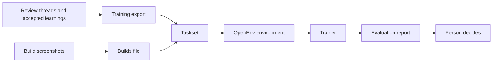

# ADR 0002: Decision model and reinforcement learning environment

Status: proposed on November 7, 2026. This proposal needs review by the Replica maintainers.

## Context

[ADR 0001](0001-learning-extension-architecture.md) made learning explicit: reviewers comment, a person accepts a learning, and agents read it. It left model training for a later stage and asked for "trainer, serving, and environment interfaces behind one promotion gate", with training data leaving the store only through a training-purpose export.

The Replica maintainers want reinforcement learning (RL) in Replica, in a place where it shows measurable gains and keeps improving as people review more prototypes. Reinforcement learning is a training method where a model answers a task, receives a numeric reward for its answer, and updates its weights to earn higher rewards. This ADR proposes the first such place: a decision model that checks Build screenshots against a repository's accepted learnings.

A vision-language model is a model that takes both an image and text as input. A decision model is a small vision-language model that looks at an image and answers typed questions with probabilities instead of prose. It answers three types of question: yes or no, one of several options, and a level on a scale. Liquid AI's d1 models answer these types as released. A general vision-language model, such as Gemma, can learn to answer them in training.

Replica already records what a decision model needs:

1. Repository administrators accept learnings, which say what a team's prototypes should do.
2. Reviewers write review threads, and Hub pins each thread to a prototype, a Build, and the page the reviewer commented on.
3. Hub records thread resolutions, including who resolved a thread and when they resolved it.
4. The build action captures Build screenshots of the start page and each declared template, at desktop and narrow widths, in light and dark themes.
5. The learning store enforces consent with a training purpose that permits nothing else, and a training export records what left the store.

## Requirements from the request

The Replica maintainers have not agreed on these yet:

- A repository administrator chooses a base model, the starting pretrained model before team-specific training, on the **Learnings** page. The list holds vision-language models under 10 billion parameters from US-based companies.
- The model checks Build screenshots against the repository's accepted learnings. The questions come from the accepted learnings, so nobody writes them by hand.
- Training uses RL in an environment that follows [OpenEnv](https://github.com/openenv/OpenEnv), an open interface that connects RL environments and trainers so a trainer can send actions and receive observations and rewards. A team runs the environment in a container it controls, or on a managed service that runs the same container.
- Training data leaves the store only through a training-purpose export, which needs its own consent grant.
- A person decides whether a trained model replaces the one in use.

## Decision

The sections below are proposed implementation choices. An operator exports review threads and accepted learnings into a training export, and exports Build screenshots into a Builds file. The `replica-learning` command combines those inputs into a taskset, which is a directory of screenshots paired with the repository's questions and expected answers from review history. An OpenEnv environment serves tasks from the taskset to a trainer, an evaluation script writes an evaluation report, and a person decides whether to promote the trained model.

### The questions come from accepted learnings

`replica-learning decision questions` turns the accepted learnings into the questions the model answers about each screenshot:

- For each learning, one yes-or-no question asks whether the page follows that learning in every screenshot. Each question is keyed by the learning's ID, so every answer names what it judges.
- One choice question asks which learning the page breaks most clearly, or none.
- One score question asks how far the page is from the learnings, on four levels.

A learning's text is quoted on one line, the way recall writes it, so a learning reads as data. One set of questions covers at most 64 learnings. The **Learnings** page shows the questions, so a person sees what the model will be asked before anyone trains it.

### Labels come from review outcomes

`replica-learning decision taskset` reads a training export and a Builds file and writes one task per labeled page of a Build into the taskset. A task is the page's screenshots, the questions, and labels, which are the expected answers derived from review outcomes for the questions the evidence answers:

| Evidence in the export | Label |
| --- | --- |
| A thread that supports an accepted learning started on a Build | That Build breaks the learning on the page the thread points to |
| The Builds file lacks one of that page's four screenshots | No "breaks" label. The problem may show only in the missing screenshot |
| The reviewer who wrote the cited comment, or the comment a cited label is about, resolved the thread after writing it, and a later Build of the prototype was published by then | The latest such Build follows the learning on that page |
| The thread was resolved before the cited comment was written, for example because someone edited the comment after the resolution | No "follows" label. Hub keeps a thread resolved when someone edits it, so the resolution did not confirm this problem |
| Two status changes on the thread share the latest time | No "follows" label. Nothing in the export says which came last |
| A thread on that later Build and page reports the same theme | No "follows" label. The fix is in doubt |
| One page gets both labels for one learning | No label for that learning |

Only the yes-or-no questions get labels. The choice and score questions stay unlabeled in this version and earn no reward.

These rules follow ADR 0001's evidence rules. Theme labels from Copilot on later comments can remove a "follows" label, but they never add a label. A resolution by the person who raised the problem is the closest record Hub has of a verified fix. Someone who only labeled the comment did not raise the problem, so their resolution does not count. The store records every resolution, including a thread resolved again since the last import, so the latest resolution is the one that counts.

"Later" follows Hub's order of Builds: when GitHub made each Build, then its number. Hub numbers Builds as it finds them, and it can find an older Build after a newer one, so the number alone is not enough.

`replica-learning decision taskset` refuses an export that differs from what the store wrote: a record the manifest does not list, a listed record that is missing, a repeated record, or an event filed under another episode. Removing one label or moving one resolution could otherwise change a label without changing any digest.

`replica-learning decision taskset` splits tasks into training, development, and test sets by prototype, so two Builds of one prototype never land in different sets. A prototype's Builds look alike, and a model could otherwise pass the test set by remembering earlier Builds of the same prototype.

`bin/rails 'replica:learning:decision_builds[<Hub repository ID>,<directory>]'` writes the Builds file in Hub. It lists the published Builds of every prototype with review comments, with when each was made and published. It copies every screenshot of each page the build action captured: desktop and narrow widths, in light and dark themes. Each page is named by the path a browser reports for it. A screenshot belongs to a comment's page only when its path, including the query and fragment, matches the page the comment points to. The command refuses a directory inside the public web root, inside Hub's learning or artifact storage, or reached through a symbolic link.

A task shows every screenshot of its page. Review comments record the page but not the width or theme the reviewer saw, so a problem the reviewer found at a narrow width or in dark theme may not show in the desktop light screenshot. A page gets a "breaks" label only when all four of its screenshots exist, so a problem that shows when the page loads, at either width in either theme, shows in at least one of them. The yes-or-no question asks whether the page follows the learning in every screenshot.

### The reward is a proper scoring rule

The model answers each question with a probability for every option. The environment rewards those probabilities with a proper scoring rule, which is a reward formula that gives the highest expected score when the stated probabilities match how often the answers turn out true:

- Yes-or-no and choice questions use the Brier score, which measures the squared difference between the stated probabilities and the actual outcome, scaled so a certain right answer earns 1 and a certain wrong answer earns 0.
- Score questions use the ranked probability score, which measures the squared difference between cumulative stated probabilities and the cumulative outcome across ordered levels so it also counts how far off an answer is.
- An episode is one run of the model on a single task, and an episode's reward is the mean over its labeled questions.

The environment scores all three types, so labels for choice and score questions need no new environment.

A reward for correct answers alone teaches a model to answer with full confidence, because confidence costs nothing when it is right. RL with right-or-wrong rewards is known to make models overconfident. Proper scoring rules instead train for calibration, which means that how often an answer turns out true matches the probability the model gave it. Calibrated probabilities matter here, because Hub will need a probability threshold to decide what to show reviewers.

### The environment runs where the team chooses

`packages/learning/environments/brand-check` is an OpenEnv environment. Each episode is one task with one step: the environment shows the page's screenshots and the questions, the policy (the model being trained or evaluated) answers with probabilities, and the environment returns the reward. Learning from one action and its reward for a given input, without a sequence of steps, is called a contextual bandit.

The environment reads a taskset from a directory mounted read-only, and the image holds no data. It answers only clients that send a secret token the team chooses, except for its health check. Without the token, another account on a shared machine, or any web page open in the operator's browser, could connect to the environment and read the screenshots and learnings. A team runs it in one of two places:

- **In its own container:** The team runs the container with Docker or Podman on a GPU machine the team controls, and training data never leaves that machine.
- **On a managed service:** The team runs the same container image and mount on any service that runs OpenEnv containers, when the team's training consent covers sending the data there.

Any trainer that speaks OpenEnv can connect, such as the Group Relative Policy Optimization (GRPO) trainer in the Transformer Reinforcement Learning (TRL) library. An evaluation script scores a policy on the development or test set and writes a report with the mean reward and the calibration error, which measures the gap between the model's stated probabilities and how often its answers are right.

### Hub keeps only the choice

Hub stores the base model a repository administrator chose and where training runs. It does not run training, keep weights, or serve the model. The base model list ships with `replica-learning decision models`, and Hub reads it from the installed command, so the two never drift.

| Model | Parameters | Answers typed questions as released | License | Commercial use |
| --- | --- | --- | --- | --- |
| [LiquidAI/d1-2B](https://huggingface.co/LiquidAI/d1-2B) | 1.9B | Yes | LFM Open License v1.0 | Limited by company revenue |
| [LiquidAI/d1-omni-600M](https://huggingface.co/LiquidAI/d1-omni-600M) | 0.6B | Yes | LFM Open License v1.0 | Limited by company revenue |
| [google/gemma-3-4b-it](https://huggingface.co/google/gemma-3-4b-it) | 4.3B | No | Gemma Terms of Use | Under the maker's terms |
| [google/gemma-4-E4B-it](https://huggingface.co/google/gemma-4-E4B-it) | 8.0B | No | Apache 2.0 | Allowed |
| [ibm-granite/granite-vision-4.1-4b](https://huggingface.co/ibm-granite/granite-vision-4.1-4b) | 4.0B | No | Apache 2.0 | Allowed |
| [microsoft/Phi-4-multimodal-instruct](https://huggingface.co/microsoft/Phi-4-multimodal-instruct) | 5.6B | No | MIT | Allowed |

The list leaves out models above 10 billion parameters and models built on a base model from a company outside the US.

### A person promotes a trained model

A trained model replaces the base model only when a repository administrator approves it. The evaluation report gives them two numbers to compare against the base model on the test set: the mean reward, which should be higher, and the calibration error, which should not be worse. This version writes the report, but Hub does not record the decision or serve a model yet.

## Consequences

- Teams can train on their own review outcomes without sending them anywhere they did not choose.
- A taskset copies screenshots and learning text. It lives under `.replica/` in a checkout, or outside any checkout. When someone withdraws training consent, `replica-learning` lists the export the taskset came from, and the owner must delete the taskset too.
- The Builds file holds screenshots of every published Build of each reviewed prototype. The operator should delete it after writing the taskset.
- A "follows" label rests on the reviewer's check of the fix, which may have covered one width and theme. The other screenshots of that page count as fixed unless a later thread reports the same theme there.
- A "breaks" label can still be wrong when the reviewer found the problem after scrolling, opening a menu, or resizing the window to another width, because the screenshots show each page as it first loads at two widths. Older Builds that kept light screenshots only give "follows" labels alone.
- Hub names each screenshot by the address the build action was asked to capture. The build action follows redirects and Controls URL defaults without recording where the page ended up, so a comment made at the address a page redirects to finds no screenshot and is skipped.
- A task shows up to four screenshots, plus the brand sheet. A model that accepts only one image needs its trainer to tile them.
- `replica-learning decision taskset` can label only pages with screenshots, and it counts comments on other pages as skipped. A repository with few resolved threads gets few "follows" labels.
- The LFM Open License limits commercial use by company revenue. A larger company needs another model or a license from Liquid AI.
- A general model needs a way to turn its output into probabilities, such as reading the probability of each option's answer token. The environment accepts probabilities from any policy, so this choice stays with the trainer.
- The **Learnings** page runs one more `replica-learning` command, in parallel with the others, and Hub reads the base model list once for each installed command.

## Alternatives considered

- **Supervised fine-tuning only:** Supervised fine-tuning trains a model directly on labeled examples without an environment. With full labels, fine-tuning on the same scoring rule learns as efficiently as RL. The environment still earns its place because it scores any model the same way, and it lets a trainer learn from partial feedback that covers only the model's own answers, which supervised fine-tuning cannot use. Supervised fine-tuning can read the same tasksets.
- **A reward for correct answers:** We rejected a right-or-wrong reward because it pushes the model to state full confidence and breaks calibration.
- **Training inside Hub:** We rejected running training inside Hub because training needs GPUs and would put training data and weights in Hub's process and storage.
- **A managed service as the only option:** We rejected requiring a managed service because some teams cannot send review data out, and the same container runs in both places.
- **Synthetic brand kits as training data:** We deferred synthetic brand kits because, while they can teach a general brand checker, a repository's own review outcomes are what decide whether a screen follows its learnings.
- **Larger models, or models built on non-US base models:** We left out models above 10 billion parameters and models built on non-US base models because they are outside the requirements.

## Where RL pays off in Replica

This version proves the environment, labels, and reward. RL gains more in places where supervised learning has no labels to learn from:

1. **Training the agent that builds prototypes:** An agent builds a prototype in a sandbox, and the decision model, the build, and later reviews score the result. Nobody can label "the right code", but a calibrated check against accepted learnings can score each attempt cheaply. Reviewers stay the ground truth, and a held-out set of human reviews catches an agent that learns to fool the checker.
2. **Learning from reviewers' answers to the model's checks:** Once Hub shows the model's flags on new Builds, reviewers confirm or dismiss them. That feedback covers only what the model flagged, which is the setting a contextual bandit learns from.
3. **Labeling comments with a trained model:** Labeling is the only step that pays for Copilot today. A small model trained on accepted labels could take over the common cases.

## Next steps

1. Run a promoted model on each new Build's screenshots and show its flags in review, with controls for reviewers to confirm or dismiss them.
2. Record evaluation reports and an administrator's promotion decision in Hub.
3. Capture screenshots of every page a comment points to, not just the start page and templates.
4. Record the width, theme, and final address of what each reviewer and each screenshot saw, so a task can show exactly what the reviewer saw.
5. Add an environment where an agent builds a prototype and the decision model is one of its graders.
