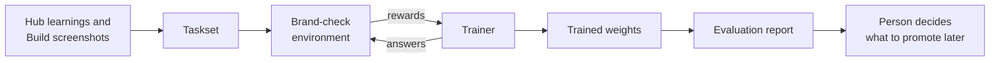
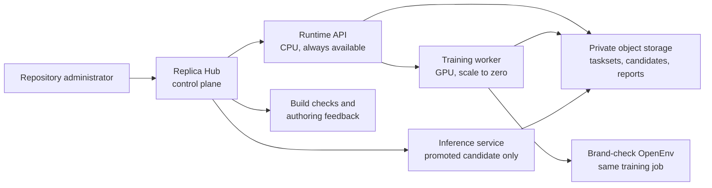

# Train a decision model

A decision model is a small vision-language model, one that reads images and text together. It answers typed questions about whether a Build's screenshots follow a repository's accepted learnings.

This guide takes a team from Hub review outcomes to a trained and evaluated model. Serving the model and using it on new Builds are separate later work. See [ADR 0002](adr/0002-decision-model-and-rl-environment.md) for the design and trade-offs.

The team runs training on infrastructure it chooses. Replica provides the taskset contract, the OpenEnv brand-check environment, an evaluation command, and a reference trainer.



## What you need

- A Hub repository with accepted learnings and recorded training consent. See [Learnings](../hub/docs/learnings.md#decision-model).
- Node.js 24, and Python 3.12 with uv.
- The Hugging Face tool, `hf`, to download the reference model.
- An NVIDIA GPU or an Apple silicon Mac for the reference trainer.

## Recommended first customer deployment

The smallest credible production deployment keeps Hub as the control plane and runs training and inference in the customer's environment. Hub currently records the base model and whether training uses a container or managed service; connecting it to the runtime is the next bounded product slice.



Use one runtime API, one training-worker profile, one inference deployment, and one private storage boundary:

| Piece | First deployment responsibility |
| --- | --- |
| Hub control plane | A repository administrator starts a bounded job, sees its state and evaluation report, and explicitly promotes a candidate. Hub stores only runtime connection metadata, job and promotion references, and the administrator's decisions. |
| Runtime API | Authenticates Hub, validates taskset and limits, records jobs, leases one job to a worker, publishes immutable candidate metadata, and changes the promotion pointer. It runs on CPU and has no model loaded. |
| Training worker | Starts only for a queued job, mounts or downloads one taskset, runs the existing brand-check environment and d1 trainer, uploads the adapter and reports, then exits. The first version runs one training job at a time per repository. |
| Inference service | Loads the promoted base model and adapter once, answers the existing `/score` contract, and reports its candidate ID. It never accepts training or promotion requests. |
| Model and taskset storage | A private object container keeps tasksets, immutable candidate adapters, and reports under repository-scoped paths. The base model is a pinned image layer or read-only model cache, not copied into every candidate. |
| Runtime state | A small persistent database or volume keeps job state, leases, candidate manifests, and promotion generations. Back it up with Hub's control-plane data. The local reference uses JSON files to prove this contract, not as the multi-instance production store. |

### Identity, secrets, and networking

Use separate workload identities rather than one shared cloud credential:

| Identity | Minimum access |
| --- | --- |
| Hub | Call the runtime control API and inference service for repositories it administers. It does not read object storage directly. |
| Runtime API | Read and write runtime metadata; create repository-scoped object paths and worker jobs. |
| Training worker | Read its named taskset and base model; write only its named candidate prefix. |
| Inference service | Read the promoted candidate and pinned base model. It cannot write candidates or change promotion. |

Use managed or workload identity for cloud resources. Keep only the Hub-to-runtime and inference credentials in the deployment's secret store, exposed to the correct process as environment variables or mounted files. The local bearer token is the single-host reference, not the preferred cloud credential. Do not put cloud keys, model-registry tokens, or runtime credentials in Hub's database, tasksets, images, or repository secrets.

Keep the runtime API, worker, object storage, and inference service on private networking. Hub is the only control-plane caller. Run Build evaluation from Hub after it imports a successful Build, rather than exposing the inference service to GitHub-hosted runners. Authoring agents can reach the same inference contract through Hub or a customer-authenticated private ingress. Do not make the training API public.

### CPU and GPU profiles

| Profile | Purpose | Scaling |
| --- | --- | --- |
| Fixture, CPU only | Installation checks, lifecycle demos, contract tests, and operator practice. It does not establish real visual-model quality. | Runtime and inference can share one small CPU container. |
| d1 training | Customer-specific post-training with the existing d1 trainer and OpenEnv reward. | Start one GPU worker for a bounded job and return to zero workers afterward. |
| d1 inference | Build and authoring evaluation with the promoted candidate. | Keep one warm GPU replica when interactive latency matters; otherwise scale to zero with an accepted cold-start delay. Do not train and serve in the same GPU process. |

### Persistence, observability, and cost controls

- Keep tasksets and candidates immutable. Promotion changes one small pointer; rollback promotes an earlier intact candidate.
- Record the training export ID and taskset digest on each candidate. When consent withdrawal names an export, delete its tasksets and derived candidates under the customer's retention process.
- Log job, candidate, repository, backend, limit, state, and duration. Do not log screenshots, learning text, tokens, or probability request bodies.
- Emit traces or metrics for queued jobs, lease age, training duration, failures by code, candidate reward delta, inference latency, active candidate, and GPU runtime. Use customer-operated OpenTelemetry collection as Hub does.
- Require `maxUpdates` and `maxSeconds`, allow one active training job per repository, cap retries, and stop failed workers. Set storage lifecycle rules for superseded tasksets and candidates only after the customer's retention policy permits deletion.
- Keep GPU workers at zero when idle. Treat a warm inference replica as an explicit monthly cost choice and show that choice beside promotion.

### Next bounded Hub integration

The next pull request should connect one Hub deployment to one customer runtime and let a repository administrator opt one repository in, without adding a general cloud scheduler:

1. Add a Hub-administrator runtime connection with one HTTPS base URL. Read its credential from `REPLICA_DECISION_RUNTIME_TOKEN`, following Hub's existing operator-secret pattern, and store only its digest for refusal tracking.
2. Add a Hub job that prepares the repository taskset in a private staging directory, uploads it through the runtime API, submits bounded training, and polls the job with capped retries.
3. Show the candidate's baseline and trained mean reward and calibration error on **Learnings**. Promotion requires a repository administrator and records a security-audit event.
4. After promotion, have Hub call the inference service for newly imported Build screenshots and expose the same endpoint to the prototype plugin for interactive authoring feedback.
5. Add provider interfaces for taskset transfer, job execution, and candidate storage only where this slice needs them. Keep the local filesystem implementation as the reference and add one workload-identity cloud implementation.

This slice depends on authenticated Hub-to-runtime calls, private taskset transfer, durable job polling, and a long-lived inference process that loads a promoted d1 model once. It deliberately leaves multi-region scheduling, pooled GPUs across customers, automatic promotion, and a Replica-hosted service out of scope.

## 1. Prepare a taskset

A taskset is a private directory of screenshots paired with the repository's questions and the answers that review outcomes imply. Each yes-or-no question asks whether the page follows one accepted learning.

A Hub operator records training consent, exports the evidence that training may use, copies Build screenshots, and writes the taskset using [Prepare training](../hub/docs/learnings.md#prepare-training). Pass a brand reference sheet with `--brand-sheet` when the model should see the team's colors, type, and components before each page.

Keep the taskset on infrastructure the team controls. It copies accepted learning text, private screenshots, and labels derived from review outcomes. When consent withdrawal identifies the source export for deletion, delete the taskset too.

## 2. Start the environment

The brand-check environment serves tasks to a trainer and scores each answer. It follows [OpenEnv](https://github.com/openenv/OpenEnv), an open interface where a trainer sends actions and receives observations and numeric rewards.

The server refuses requests without a shared secret token. [Token](../packages/learning/environments/brand-check/README.md#token) shows how to make one. Set `REPLICA_ENV_TOKEN` in every shell that runs the server or trainer, then run these commands from a Replica checkout:

```sh
cd packages/learning/environments/brand-check
uv venv --python 3.12
uv pip install -e .
REPLICA_TASKSET_DIR=/path/to/taskset .venv/bin/server --port 8000
```

For a container, follow [Run it in a container](../packages/learning/environments/brand-check/README.md#run-it-in-a-container). Keep a local connection on loopback. A remote trainer must connect through HTTPS, such as a TLS proxy in front of the container, because the client refuses to send the token and screenshots over plaintext.

## 3. Train and evaluate

The reference trainer, `train_d1_omni.py`, post-trains Liquid AI's d1-omni-600M. It freezes the released model and trains a readout, 1,025 numbers that correct yes-or-no answers using environment rewards. Every 10 updates it scores the development split and saves the best weights so far in `best.pt`.

Open a second shell in `packages/learning/environments/brand-check` and set `REPLICA_ENV_TOKEN` there too. Download the pinned model to a local directory, review the model's Python code, then train and evaluate:

```sh
uv pip install torch torchvision "transformers>=5.14" pillow
hf download LiquidAI/d1-omni-600M \
  --revision 02b55d7076f15129e59ab3f94783f32c4b088674 \
  --local-dir models/d1-omni-600M
export REPLICA_TRUSTED_MODEL_DIRS="$(pwd)/models/d1-omni-600M"
.venv/bin/python examples/train_d1_omni.py train \
  --allow-insecure-loopback --model models/d1-omni-600M \
  --taskset /path/to/taskset --out runs/team
.venv/bin/python examples/train_d1_omni.py evaluate \
  --allow-insecure-loopback --model models/d1-omni-600M --taskset /path/to/taskset \
  --split test --name released --out runs/team
.venv/bin/python examples/train_d1_omni.py evaluate \
  --allow-insecure-loopback --model models/d1-omni-600M --taskset /path/to/taskset \
  --trained runs/team/best.pt --split test --name trained --out runs/team
```

The trainer accepts only a local model directory named in `REPLICA_TRUSTED_MODEL_DIRS` and loads only files already present there. Separate several approved absolute paths with the operating system's path separator. The model still runs custom Python code, so review a directory before adding it to the allowlist. The commands above opt into plaintext loopback for a single-user training machine. On a shared host, omit `--allow-insecure-loopback` and use an HTTPS endpoint.

Choose settings against the development split. Score the test split only once after choosing the weights, so it remains an honest comparison. Compare `released-test-report.json` with `trained-test-report.json`: mean reward should improve, and expected calibration error should not get worse.

See [Train d1-omni-600M](../packages/learning/environments/brand-check/README.md#train-d1-omni-600m) for the reference results, or [Connect a trainer](../packages/learning/environments/brand-check/README.md#connect-a-trainer) to use another OpenEnv trainer.
