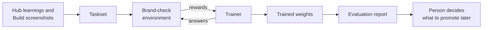

# Train a decision model

A decision model is a small vision-language model, one that reads images and text together. It answers typed questions about whether a Build's screenshots follow a repository's accepted learnings.

This guide takes a team from Hub review outcomes to a trained and evaluated model. Serving the model and using it on new Builds are separate later work. See [ADR 0002](adr/0002-decision-model-and-rl-environment.md) for the design and trade-offs.

The team runs training on infrastructure it chooses. Replica provides the taskset contract, the OpenEnv brand-check environment, an evaluation command, and a reference trainer.



## What you need

- A Hub repository with accepted learnings and recorded training consent. See [Learnings](../hub/docs/learnings.md#decision-model).
- Node.js 24, and Python 3.12 with uv.
- The Hugging Face tool, `hf`, to download the reference model.
- An NVIDIA GPU or an Apple silicon Mac for the reference trainer.

## 1. Prepare a taskset

A taskset is a private directory of screenshots paired with the repository's questions and the answers that review outcomes imply. Each yes-or-no question asks whether the page follows one accepted learning.

A Hub operator records training consent, exports the evidence that training may use, copies Build screenshots, and writes the taskset using [Prepare training](../hub/docs/learnings.md#prepare-training). Pass a brand reference sheet with `--brand-sheet` when the model should see the team's colors, type, and components before each page.

Keep the taskset on infrastructure the team controls. It copies accepted learning text, private screenshots, and labels derived from review outcomes. When consent withdrawal identifies the source export for deletion, delete the taskset too.

## 2. Start the environment

The brand-check environment serves tasks to a trainer and scores each answer. It follows [OpenEnv](https://github.com/openenv/OpenEnv), an open interface where a trainer sends actions and receives observations and numeric rewards.

The server refuses requests without a shared secret token. [Token](../packages/learning/environments/brand-check/README.md#token) shows how to make one. Set `REPLICA_ENV_TOKEN` in every shell that runs the server or trainer, then run these commands from a Replica checkout:

```sh
cd packages/learning/environments/brand-check
uv venv --python 3.12
uv pip install -e .
REPLICA_TASKSET_DIR=/path/to/taskset .venv/bin/server --port 8000
```

For a container, follow [Run it in a container](../packages/learning/environments/brand-check/README.md#run-it-in-a-container). Keep a local connection on loopback. A remote trainer must connect through HTTPS, such as a TLS proxy in front of the container, because the client refuses to send the token and screenshots over plaintext.

## 3. Train and evaluate

The reference trainer, `train_d1_omni.py`, post-trains Liquid AI's d1-omni-600M. It freezes the released model and trains a readout, 1,025 numbers that correct yes-or-no answers using environment rewards. Every 10 updates it scores the development split and saves the best weights so far in `best.pt`.

Open a second shell in `packages/learning/environments/brand-check` and set `REPLICA_ENV_TOKEN` there too. Download the pinned model to a local directory, review the model's Python code, then train and evaluate:

```sh
uv pip install torch torchvision "transformers>=5.14" pillow
hf download LiquidAI/d1-omni-600M \
  --revision 02b55d7076f15129e59ab3f94783f32c4b088674 \
  --local-dir models/d1-omni-600M
export REPLICA_TRUSTED_MODEL_DIRS="$(pwd)/models/d1-omni-600M"
.venv/bin/python examples/train_d1_omni.py train \
  --model models/d1-omni-600M --taskset /path/to/taskset --out runs/team
.venv/bin/python examples/train_d1_omni.py evaluate \
  --model models/d1-omni-600M --taskset /path/to/taskset \
  --split test --name released --out runs/team
.venv/bin/python examples/train_d1_omni.py evaluate \
  --model models/d1-omni-600M --taskset /path/to/taskset \
  --trained runs/team/best.pt --split test --name trained --out runs/team
```

The trainer accepts only a local model directory named in `REPLICA_TRUSTED_MODEL_DIRS` and loads only files already present there. Separate several approved absolute paths with the operating system's path separator. The model still runs custom Python code, so review a directory before adding it to the allowlist.

Choose settings against the development split. Score the test split only once after choosing the weights, so it remains an honest comparison. Compare `released-test-report.json` with `trained-test-report.json`: mean reward should improve, and expected calibration error should not get worse.

See [Train d1-omni-600M](../packages/learning/environments/brand-check/README.md#train-d1-omni-600m) for the reference results, or [Connect a trainer](../packages/learning/environments/brand-check/README.md#connect-a-trainer) to use another OpenEnv trainer.
