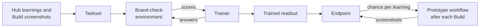

# Train and serve a decision model

A decision model is a small vision-language model, one that reads images and text together. It checks a Build's screenshots and gives the chance that the page follows each accepted learning.

This guide takes a team from Hub review outcomes to a trained model on an endpoint (a web address for model requests), then to a prototype workflow that checks every Build. See [ADR 0002](adr/0002-decision-model-and-rl-environment.md) for the design and trade-offs.

You train on a machine your team controls, and serve there or on an Azure Machine Learning managed online endpoint (a hosted web address on an Azure machine). Hub-based Microsoft Foundry projects use these same endpoints, and a later section compares Foundry's other options.



## What you need

- A Hub repository with accepted learnings and recorded training consent. See [Learnings](../hub/docs/learnings.md#decision-model).
- Node.js 24, and Python 3.12 with uv (a fast Python package installer).
- The Hugging Face tool, `hf`, to download the model.
- For training: an NVIDIA GPU (a graphics chip for model math) or an Apple silicon Mac.
- For Azure serving: an Azure subscription, Azure CLI with its `ml` extension, an Azure Machine Learning workspace or hub-based Foundry project, and regional GPU quota.

## 1. Prepare a taskset

A taskset is a folder of screenshots paired with the repository's questions and the answers that review outcomes imply. Each question asks whether the page follows one accepted learning.

A Hub operator records training consent, exports learnings, copies Build screenshots, and writes the taskset using [Prepare training](../hub/docs/learnings.md#prepare-training). Pass a brand reference sheet (one image of colors, type, and components) with `--brand-sheet` so the model sees it first in every task, and send that same image later when asking the model. Keep the taskset on a machine your team controls because it holds private screenshots.

## 2. Start the environment

The brand-check environment serves tasks from the taskset to a trainer and scores each answer. It follows OpenEnv, an open standard for reinforcement learning environments, where the model answers tasks and learns from numeric scores instead of copying example answers.

The server refuses requests without a shared secret token. [Token](../packages/learning/environments/brand-check/README.md#token) shows how to make one. Set `REPLICA_ENV_TOKEN` in every shell that runs the server or the trainer, then run these commands from a Replica checkout. To use a container instead, follow [Run it in a container](../packages/learning/environments/brand-check/README.md#run-it-in-a-container).

```sh
cd packages/learning/environments/brand-check
uv venv --python 3.12
uv pip install -e .
REPLICA_TASKSET_DIR=/path/to/taskset .venv/bin/server --port 8000
```

## 3. Train and check the gain

The trainer, `train_d1_omni.py`, post-trains Liquid AI's d1-omni-600M, a 600 million parameter vision-language model (parameters are adjustable model numbers). It freezes the released model and trains a readout, 1,025 numbers that correct yes-or-no answers using only environment scores. Every 10 updates it scores the development split, a set of pages kept out of training for tuning, and saves the best weights so far in `best.pt`. A model trained on a small taskset can start to memorize it, which is called overfitting, so the best development score marks the version to keep.

Open a second shell in `packages/learning/environments/brand-check` and set `REPLICA_ENV_TOKEN` there too. The commands below install the trainer's packages, download the model, train, and score the released and trained models. The model runs its own Python code from `models/d1-omni-600M`, so review that code after the download and before you train.

```sh
uv pip install torch torchvision "transformers>=5.14" pillow
hf download LiquidAI/d1-omni-600M --revision 02b55d7076f15129e59ab3f94783f32c4b088674 --local-dir models/d1-omni-600M
.venv/bin/python examples/train_d1_omni.py train --model models/d1-omni-600M --taskset /path/to/taskset --out runs/team
.venv/bin/python examples/train_d1_omni.py evaluate --model models/d1-omni-600M --taskset /path/to/taskset --split test --name released --out runs/team
.venv/bin/python examples/train_d1_omni.py evaluate --model models/d1-omni-600M --taskset /path/to/taskset --trained runs/team/best.pt --split test --name trained --out runs/team
```

Compare `released-test-report.json` with `trained-test-report.json` in `runs/team`. Choose settings on the development split and score the test split only once, so the test score stays honest. See [Train d1-omni-600M](../packages/learning/environments/brand-check/README.md#train-d1-omni-600m) for details and practice results, or [Connect a trainer](../packages/learning/environments/brand-check/README.md#connect-a-trainer) for your own trainer.

## 4. Serve the model

[`score_d1_omni.py`](../packages/learning/environments/brand-check/examples/score_d1_omni.py) serves the model using the managed online endpoint contract: `init()` loads the model once and `run()` answers each request. We tested the script locally against the real model, but we have not deployed it on Azure, so test the deployment before your team relies on it.

From the same folder, gather the model and the code in `deploy/`, which Git ignores:

```sh
mkdir -p deploy/model deploy/code
cp -R models/d1-omni-600M deploy/model/
cp runs/team/best.pt deploy/model/
cp examples/score_d1_omni.py examples/train_d1_omni.py deploy/code/
```

Write three files in `deploy/`. `conda.yml` lists the Python packages:

```yaml
name: replica-decision
channels:
  - conda-forge
dependencies:
  - python=3.12
  - pip
  - pip:
      - azureml-inference-server-http
      - torch
      - torchvision
      - transformers>=5.14
      - pillow
```

`endpoint.yml` names the endpoint and sets key authentication:

```yaml
$schema: https://azuremlschemas.azureedge.net/latest/managedOnlineEndpoint.schema.json
name: replica-decision
auth_mode: key
```

`deployment.yml` picks the model folder, scoring script, GPU image, and one NVIDIA T4 GPU (60 seconds per request):

```yaml
$schema: https://azuremlschemas.azureedge.net/latest/managedOnlineDeployment.schema.json
name: blue
endpoint_name: replica-decision
model:
  path: model
code_configuration:
  code: code
  scoring_script: score_d1_omni.py
environment:
  conda_file: conda.yml
  image: mcr.microsoft.com/azureml/openmpi4.1.0-cuda11.8-cudnn8-ubuntu22.04:latest
instance_type: Standard_NC4as_T4_v3
instance_count: 1
request_settings:
  request_timeout_ms: 60000
```

Then deploy. An endpoint's name must be unique in its Azure region, 3 to 32 characters long, start with a letter, and use only letters, numbers, and single dashes. Creating the deployment can take about 15 minutes.

```sh
cd deploy
az extension add --name ml
az login
az configure --defaults group=<resource group> workspace=<workspace or hub-based project>
ENDPOINT=replica-decision-<your team>
az ml online-endpoint create --name "$ENDPOINT" -f endpoint.yml
az ml online-deployment create --name blue --endpoint "$ENDPOINT" -f deployment.yml --all-traffic
```

Save the address and key:

```sh
export REPLICA_DECISION_ENDPOINT="$(az ml online-endpoint show --name "$ENDPOINT" --query scoring_uri -o tsv)"
export REPLICA_DECISION_KEY="$(az ml online-endpoint get-credentials --name "$ENDPOINT" --query primaryKey -o tsv)"
```

Managed online endpoints never scale to zero and bill hourly until deleted:

```sh
az ml online-endpoint delete --name "$ENDPOINT" --yes --no-wait
```

The endpoint runs d1-omni-600M's own Python code from `deploy/model`, so review that code before you deploy. To serve another model, write a scoring script that accepts the same request and returns the same answers, as the opening comment of `score_d1_omni.py` shows.

## 5. Ask from a prototype

`replica-learning decision ask` sends a Build's screenshots and questions to the endpoint and prints each learning's chance, lowest first (or JSON with `--json`). It reads `--endpoint` or `REPLICA_DECISION_ENDPOINT`, reads `REPLICA_DECISION_KEY` only from the environment, and requires `https://` except on your own computer.

First, the Hub operator saves the questions on the Hub host:

```sh
node /opt/replica/learning/bin/replica-learning.mjs decision questions --json \
  --dir storage/learning/repositories/<Hub repository ID> \
  --repository github.com/repositories/<GitHub repository ID> > decision-questions.json
```

Commit that file to the prototype repository as `.replica/decision-questions.json`, with the brand reference sheet if the taskset used one, and refresh it when the learnings change. It holds the accepted learnings' text, which the team's agents already receive.

To ask about a Build you downloaded, run this from a Replica checkout. Add `--brand-sheet <image>` if the taskset used a brand sheet. For a template page, pass its folder under `screenshots/templates/` and its route with `--route`.

```sh
node packages/learning/bin/replica-learning.mjs decision ask \
  --questions /path/to/prototype/.replica/decision-questions.json --screenshots /path/to/build/screenshots
```

To ask after every Build, add a second workflow to the prototype repository. Hub's generated workflow, named Replica, builds the prototype and uploads its screenshots in an artifact named `replica-build-v1`, and a separate file leaves that workflow unchanged. Save the endpoint's address as the repository variable `REPLICA_DECISION_ENDPOINT` and its key as the repository secret `REPLICA_DECISION_KEY`. Replace `<reviewed Replica commit SHA>` with a Replica commit you reviewed, then save this as `.github/workflows/replica-decision.yml`:

```yaml
name: Replica decision check
on:
  workflow_run:
    workflows: [Replica]
    types: [completed]
permissions:
  actions: read
  contents: read
jobs:
  ask:
    if: github.event.workflow_run.conclusion == 'success'
    runs-on: ubuntu-latest
    steps:
      - uses: actions/checkout@3d3c42e5aac5ba805825da76410c181273ba90b1 # v7.0.1
        with:
          sparse-checkout: .replica
      - uses: actions/checkout@3d3c42e5aac5ba805825da76410c181273ba90b1 # v7.0.1
        with:
          repository: github/replica
          ref: <reviewed Replica commit SHA>
          path: replica
          sparse-checkout: packages/learning
      - uses: actions/setup-node@949feb2413d6458794dcd2491c4babbbce0c15c1 # v7.1.0
        with:
          node-version: 24
      - uses: actions/download-artifact@9000827ccba6bdab643e8b6fd33ac0654aef8333 # v8.0.2
        with:
          name: replica-build-v1
          path: build
          run-id: ${{ github.event.workflow_run.id }}
          github-token: ${{ github.token }}
      - name: Ask the decision model
        env:
          REPLICA_DECISION_ENDPOINT: ${{ vars.REPLICA_DECISION_ENDPOINT }}
          REPLICA_DECISION_KEY: ${{ secrets.REPLICA_DECISION_KEY }}
        run: |
          {
            echo '```text'
            node replica/packages/learning/bin/replica-learning.mjs decision ask \
              --questions .replica/decision-questions.json --screenshots build/screenshots
            echo '```'
          } >> "$GITHUB_STEP_SUMMARY"
```

After each successful Build, the job reads the questions from the default branch, downloads that Build's screenshots, asks the endpoint, and writes the answers to the run's summary page. It treats the artifact as images only and never runs code from it.

## Microsoft Foundry options

Microsoft Foundry is Microsoft's platform for building with AI models, and this table compares its services for this model today.

| Foundry option | What it does | Fits d1-omni-600M with its readout? |
| --- | --- | --- |
| Managed online endpoint (Azure Machine Learning, used by hub-based projects) | Runs your model folder and scoring script on a GPU you choose | Yes. Step 4 uses it |
| Managed compute (preview) | Serves models from the Foundry catalog's Hugging Face collection on runtimes such as vLLM | No. It serves only screened catalog models, and it excludes models that run their own code, such as d1-omni-600M |
| Adapter deployments (preview) | Adds LoRA adapters, small sets of extra weights, to a managed compute deployment | No. Adapters must come from fine-tuning in Foundry, and the readout is not a LoRA adapter |
| Programmed Training (preview) | Runs your own training loop in Python while Foundry samples the model and updates LoRA weights on its GPUs | Not for d1-omni-600M. It trains only a listed set of larger base models |

### Ask a catalog model on managed compute

Managed compute serves catalog vision-language models over the OpenAI chat API. Pass `--model` so `decision ask` sends each question as a chat message and reads the "Yes" chance from log probabilities (scores for each next word), using the catalog model's own judgment instead of your reinforcement learning results. Set `REPLICA_DECISION_KEY` to the Foundry account key or a Microsoft Entra token for `https://ai.azure.com/.default`. We have not tested this on Foundry. The runtime must accept images and return log probabilities, and the deployment bills for each GPU hour until you delete it.

```sh
node packages/learning/bin/replica-learning.mjs decision ask \
  --endpoint https://<account>.services.ai.azure.com/openai/v1 --model <deployment name> \
  --questions /path/to/prototype/.replica/decision-questions.json --screenshots /path/to/build/screenshots
```

### Post-train with Programmed Training

Programmed Training needs approved preview access. Your program could send each task to a supported model, score the answer with the brand-check environment, and use that score as the reward, the same loop step 3 runs locally. Replica does not include that program yet, and Foundry's documentation does not yet show how to serve a Programmed Training result.

Microsoft's guides:

- [Azure Machine Learning online endpoints](https://learn.microsoft.com/azure/machine-learning/how-to-deploy-online-endpoints)
- [Foundry managed compute](https://learn.microsoft.com/azure/foundry/concepts/managed-compute-overview)
- [Adapter deployments](https://learn.microsoft.com/azure/foundry/concepts/adapter-deployment-overview)
- [Programmed Training](https://learn.microsoft.com/azure/foundry/fine-tuning/programmed-training/overview)

## Privacy and cost

- The taskset holds private screenshots and review labels, so train where your team controls the data. See [Privacy](../packages/learning/environments/brand-check/README.md#privacy).
- An endpoint receives Build screenshots and learning text, so use only services your team's data rules allow.
- Keep the endpoint key in a secret. `decision ask` never prints it.
- Delete unused endpoints and deployments because both bill for their GPUs while they exist.
