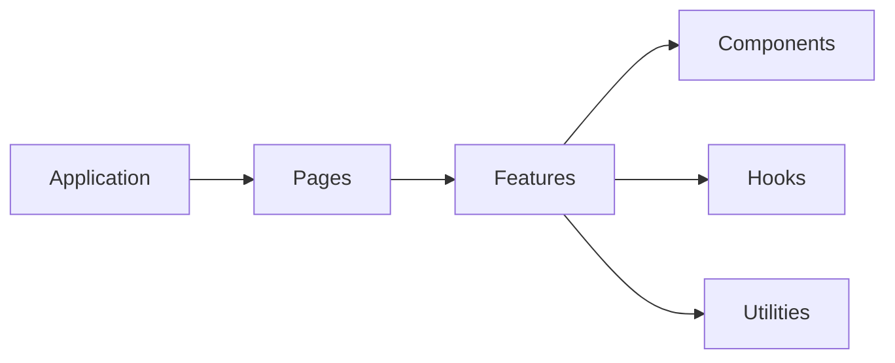

# Hub architecture

## What works now

Hub contributors are rebuilding the app on `build/hub/new` before merging it into `main`. Infrastructure changes use task branches and pull requests targeting that feature branch.

The team has chosen TypeScript, Express for the API, React and Vite for the frontend, and Vitest for tests. The old backend and the frontend code that connected to it have been removed rather than rewritten.

The API responds to a health check and gives signed-in members access to the repository index, prototype details, Build history, successful Build previews, prototype metadata edits, draft registration, persisted prototype review conversations, and local Build share-link management. Development-only local mode can discover prototype repositories, create Builds from committed local branch heads, and expose an explicitly enabled immutable Build through an opaque public link without a GitHub App. The frontend connects the retained pages for local exploration. Storybook remains the presentation workbench.

Hub uses PostgreSQL and Prisma with provider-neutral identities, GitHub and single-tenant Microsoft Entra sign-in, and explicit administrator enrollment. Hub discovers repositories in the configured GitHub App installation and scopes GitHub member reads to their repository access. [Hosted Build import](github-actions-builds.md) retrieves GitHub Actions artifacts using webhooks and recovery polling. Separate dist and screenshot imports can make previews available before screenshots finish.

[Review collaboration](review-collaboration.md) includes persisted reactions, mentions, unread state, Inbox, and live review refreshes.

The development API can explicitly enable local mode without a GitHub App. Startup prepares an ignored prototype root and the shared Build action dependencies, and seeds one deterministic Starter repository only while that root is empty. Local discovery and Build synchronization persist successful package artifacts, which the authenticated preview layer serves from Build-specific origins.

The [production runtime](deployment.md) serves the built frontend and API and runs both workers in one image. Deployment runs database and job setup separately before starting that image. The Azure installation uses an explicit startup entrypoint to retrieve configured Key Vault values through each workload's managed identity before importing provisioning, setup, or runtime code. Local entrypoints and direct environment configuration remain unchanged.

## Backend

API code lives under `server/`. As features are added, route handlers will read requests, call domains, and return responses. The [code conventions](backend-architecture.md) explain repositories, integrations, utilities, domains, and which layers may import others. Put these directories under `server/` when they are needed; do not add empty implementations.

`GET /api/health` returns `{ "status": "ok" }`; `GET /api/ready` reports operational readiness. Configured authentication routes expose explicit GitHub and Entra starts and callbacks, complete admission, restore the current session, and sign out. Unknown API paths return a JSON 404 response; invalid JSON is rejected before routing. `createApp()` builds the Express app without starting a server. `server/index.ts` selects a runtime role and defaults to the local API.

The [database guide](database.md) defines the multi-file Prisma schema and shared client in integrations. The health route remains a process check, not a database readiness check.

The [Pino integration](logging.md) writes structured application and HTTP logs to stdout. `createApp()` installs request logging before routes, so new endpoints inherit completion records and server-generated request IDs without explicit logging calls. Authentication routes install their bounded form parsing after origin and rate-limit checks. Prototype edits check the application origin before bounded JSON parsing, including case and trailing-slash aliases. GitHub webhooks use raw request bodies for signature verification; other routes inherit the shared JSON parser.

The [prototype details editor](frontend.md#prototype-metadata-edits) lets signed-in members edit visible prototypes and register drafts. Hub holds session authority and prototype visibility locks through the write and detail read-back.

The [background-job foundation](background-jobs.md) uses BullMQ with PostgreSQL and separate on-demand and scheduled worker processes. Setup migrates BullMQ's own schema independently of Prisma. The on-demand worker registers user-requested learning runs, review redaction, local Build synchronization, and GitHub workflow run imports. The scheduled worker runs opt-in daily learning discovery and automatic runs, learning recovery, GitHub installation reconciliation every 15 minutes, and [GitHub Build recovery](github-actions-builds.md#recovery).

The [development local Build flow](development.md#build-local-prototype-repositories) scans immediate child Git repositories under one configured root. It records local repositories, branch prototypes, exact commit Builds, branch-head observations, and immutable package files through the normal Prisma and artifact-storage boundaries. It checks out committed revisions in isolated Git worktrees and runs the shared Replica build action without GitHub or GitHub Actions. This flow is not enabled in hosted or production modes.

The [artifact storage domain](artifact-storage.md) selects filesystem or managed-identity Azure Blob storage behind one immutable-byte contract. Product domains call this provider-neutral API, not SDK integrations directly. Startup validates explicitly configured storage. Local Build synchronization writes package files, and the [Build preview layer](build-previews.md) reads successful Build files and screenshots through the same contract after authenticated Hub authorization, then serves them from Build-specific origins. [Public Build sharing](share-links.md) uses the same serving path with a separate public grant and cookie, Build-pinned links, and live revocation checks. Hosted sharing requires deployment opt-in and fresh GitHub repository permission; local sharing keeps its existing policy.

The [review collaboration flow](review-collaboration.md) stores Build-pinned element and area conversations without changing immutable artifacts. The retained prototype screen uses the isolated preview bridge and real review API. Local sessions can review configured local repositories, while GitHub sessions can review only connected repositories visible through their current installation access.

The [telemetry integration](telemetry.md) sends explicit server-side OpenTelemetry spans to an optional operator-configured recipient. [Repository analytics](analytics.md) separately retains product events and can deliver them to repository destinations when an operator enables delivery. Security audit data never enters the analytics pipeline.

[WebSocket updates](websockets.md) tell authorized review clients when saved conversations change. PostgreSQL notifies each API process after the write commits. The browser reloads authorized review data over HTTP after a notice or reconnect.

The identity foundation stores Hub users, immutable external identity mappings, selected authentication provider revision digests, administrator-managed assignment history, and bounded security audits. It does not store provider configuration. A provider adapter must validate its typed public configuration before the kernel computes a digest and starts the database transaction.

Domain operations receive only the transaction-scoped repositories they need. A successful state change and its success audit commit together. The kernel applies one fixed bounded retry policy to expected serializable and aggregate-creation races so consumers cannot disable convergence. A rejected database operation rolls back before its final denial or failure audit is written. Accepted provider evidence that revokes authority may commit its transition and denial audits together while issuing no session. External provider-validation failures write one typed audit after validation returns and before the operation fails. Audit callers select a typed kernel event; the repository builds the stored action and allowlisted context.

The [authentication and session flow](authentication.md) uses this foundation to validate explicit GitHub and [Microsoft Entra OIDC](entra-oidc.md) configuration, complete provider user authentication, resolve the immutable external identity, apply current provider-owned assignment evidence, decide current Hub admission, and issue an opaque browser session. An installation may configure either or both providers, and provider network work remains outside identity transactions.

The administrator-management API and retained frontend list and search existing Hub users, designate one to 50 administrators, and revoke one administrator-managed assignment. Sensitive role changes reuse the current session's GitHub, Entra, or local authorization flow and bind one short-lived, one-use continuation to the live session, external identity, operation, and target memberships. The callback and mutation reread current authority before changing roles. This surface does not invite users or manage general membership lifecycle.

The security-audit API and frontend list records newest first using opaque cursors. The Hub scope lists identity and administrator actions for a current Hub administrator. The repository scope verifies current GitHub repository-admin permission and returns only records written for that repository. The fixed local administrator can view audits for configured local repositories. Both scopes use allowlisted context and exclude export, retention changes, and deletion.

The administrator session-revocation API and retained frontend show current Hub authentication counts and require explicit confirmation plus fresh authorization through the current session provider. Continuing one verified operation atomically advances the global revision, cancels other open sensitive authorizations, ends every open Hub session, and records the security audit. It does not revoke Copilot connections or change product data.

The deployment-wide Copilot connection API and retained `/settings/copilot` frontend require a live administrator session. Hub obtains a credential from the configured provider and verifies it through the separate `replica-learning` process, then locks the persistent connection generation and rereads authority before committing the connection and typed security audit together. The database stores the provider key and configuration digest, never the credential.

The [learning foundation](learning-foundation.md) validates private storage, isolates the command's environment and temporary state, bounds output and execution time, and provides a PostgreSQL execution lock plus repository-store preparation primitive. Current GitHub admin permission supplies reusable repository-management authority independently from Hub deployment administration. The repository API uses that authority to read exact review evidence, accepted guidance, recall, and persisted run history; record accept, edit, reject, and retire decisions through the package store; and queue explicit runs. Workers import complete [review backend](review-collaboration.md) snapshots, label and consolidate within fixed bounds, preserve usage and failures, and redact deleted comment text.

The [decision-model control plane](decision-model-control-plane.md) adds provider-neutral contracts for customer-operated training and inference. It persists repository opt-in, bounded settings, pinned evidence and artifact digests, runtime references, promotion generations, Build evaluation findings, and usage metadata. Runtime credentials, private tasksets, screenshots, learning text, reports, and weights stay outside PostgreSQL. Hub composes eligible reviewed prototypes, immutable Build screenshots, and permitted learning exports into deterministic private tasksets through the learning-package contracts. The repository overview exposes deterministic preparation coverage, and completed Build evaluations project learning IDs and exact captured views from the existing evaluation record. Activation still requires a conforming runtime with Hub's transfer and cancellation interfaces.

## Frontend

Browser source lives directly under `client/`. Application code under `client/application/hub/` configures React Router Framework SPA Mode, calls the shared `fetch`/Zod request layer, and maps response records to page props. Pages assemble whole screens from typed props. Features combine components for one task. Components are reusable interface elements that do not need to know the larger task.

Imports follow the arrows above. Shared components, hooks, and utilities must not import pages, features, or application code. Keep browser and server code separate. Agree on the API before adding types shared between them.

The theme provider wraps routes and their loading and error feedback.

- In real mode, signed-in routes share a navigation layout. Pages load their own authorized data without rebuilding navigation. Signed-out visitors use the authentication shell. The [frontend guide](frontend.md#loading-and-notifications) describes the layout and its standalone routes.
- In mock mode, the root reads the simulated session. A nested layout loads the private workspace for signed-in pages.
- Route loaders and actions request product data and refresh it after changes. Shareable filters and selections live in the URL.
- Product screens keep product-facing copy. API failures remain visible errors.

The application adapts internal links and GET forms to SPA navigation. Authentication POST forms use native browser submissions. Explicit adapters submit supported product mutations; unknown legacy form submissions receive visible feedback. The [frontend guide](frontend.md) owns the connected routes and local development modes.

## Other projects

The starter, build action, learning package, and Copilot prototype extension remain separate projects. The extension and build action import or bundle shared canvas and Controls code from `client/`. The [Canvas connection](prototype-canvas.md#connect-and-revoke) uses repository-scoped credentials independent of Hub's browser session.
