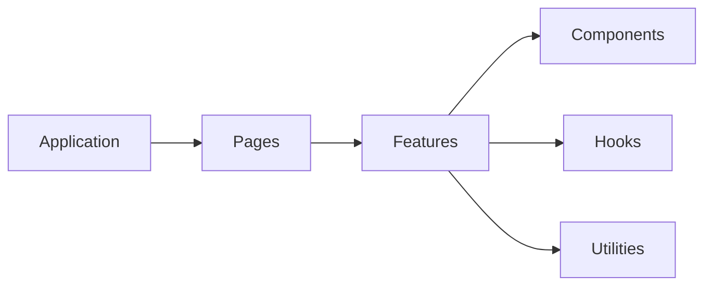

# Hub architecture

## What works now

Hub contributors are rebuilding the app on `build/hub/new` before merging it into `main`. Infrastructure changes use task branches and pull requests targeting that feature branch.

The team has chosen TypeScript, Express for the API, React and Vite for the frontend, and Vitest for tests. The old backend and the frontend code that connected to it have been removed rather than rewritten.

The API responds to a health check and provides the [identity API](identity.md). The frontend provides the local [identity provider demo](identity-provider-demo.md) with light and dark themes. Storybook keeps the existing components and pages available for reuse.

Contributors can use PostgreSQL and Prisma locally or in the devcontainer. Identity models store credentials, users, sessions, one-use OAuth attempts, and security records. Deployment, background jobs, and product APIs have not been built. This app cannot yet list repositories in the frontend, import Builds, host previews, save product data, or support reviews.

## Backend

API code lives under `server/`. [Routes](backend-architecture.md#routes) mirror URL paths and HTTP methods. They parse requests, call backend functions, and send responses. The [code conventions](backend-architecture.md) define the backend layers and their import boundaries.

`GET /api/health` returns `{ "status": "ok" }`. The [identity guide](identity.md#api-operations) lists the other API operations. Unknown paths return a JSON 404 response. `createApp()` builds the Express app without starting a server. `server/index.ts` configures the selected credential provider and starts the API at a local address.

The [database guide](database.md) defines the multi-file Prisma schema and shared client in integrations. The health route remains a process check, not a database readiness check.

## Frontend

Keep the existing `app/javascript/` layout. Application code starts React and connects the identity onboarding page to the API. Pages assemble whole screens from typed props. Features combine components for one task. Components are reusable interface elements that do not need to know the larger task.

Imports follow the arrows above. Shared components, hooks, and utilities must not import pages, features, or application code. Keep browser and server code separate. Agree on the API before adding types shared between them.

The frontend displays the existing logo inside the theme provider. Existing pages and features use ordinary browser links. Their old destinations do not exist in the new API; keeping the interface does not make those features work.

## Other projects

The starter, build action, learning package, and Copilot prototype extension remain separate projects. Canvas and Controls code stays at its existing `app/javascript/` paths so those projects can keep using it. Connecting the canvas to this Hub will require new API routes.
