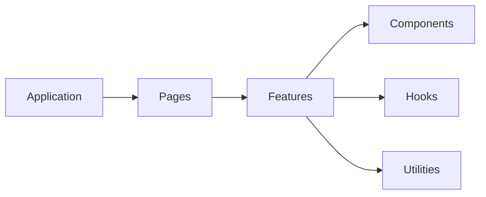

# Hub architecture

## What works now

Hub contributors are rebuilding the app on `build/hub/new` before merging it into `main`. Infrastructure changes use task branches and pull requests targeting that feature branch.

The team has chosen TypeScript, Express for the API, React and Vite for the frontend, and Vitest for tests. The old backend and the frontend code that connected to it have been removed rather than rewritten.

The API responds to a health check. The frontend connects all retained pages through an explicit local mock mode, including prototype creation, reviews, sharing, account/setup, and administrative flows. Storybook remains the presentation workbench. These simulations do not implement real authentication, permission enforcement, publishing, or backend product services.

Contributors can use PostgreSQL and Prisma locally or in the devcontainer. The database has no product models yet. Production sign-in, deployment, and product APIs have not been built. The app cannot yet discover real repositories, import Builds, host published previews, persist product data, or support live multi-user reviews.

## Backend

API code lives under `server/`. As features are added, route handlers will read requests, call domains, and return responses. The [code conventions](backend-architecture.md) explain repositories, integrations, utilities, domains, and which layers may import others. Put these directories under `server/` when they are needed; do not add empty implementations.

The only route is `GET /api/health`, which returns `{ "status": "ok" }`. Unknown paths return a JSON 404 response; invalid JSON is rejected before routing. `createApp()` builds the Express app without starting a server. `server/index.ts` starts it at a local address.

The [database guide](database.md) defines the multi-file Prisma schema and shared client in integrations. The health route remains a process check, not a database readiness check.

The [Pino integration](logging.md) writes structured application and HTTP logs to stdout. `createApp()` installs request logging and JSON parsing before routes, so new endpoints inherit completion records and server-generated request IDs without explicit logging calls.

The [background-job foundation](background-jobs.md) uses BullMQ with PostgreSQL and separate on-demand and scheduled worker processes. Setup migrates BullMQ's own schema independently of Prisma. Product processors and schedules are not registered yet.

## Frontend

Browser source lives directly under `app/`. Application code under `app/application/hub/` configures React Router Framework SPA Mode, calls the shared `fetch`/Zod request layer, and maps response records to page props. Pages assemble whole screens from typed props. Features combine components for one task. Components are reusable interface elements that do not need to know the larger task.

Imports follow the arrows above. Shared components, hooks, and utilities must not import pages, features, or application code. Keep browser and server code separate. Agree on the API before adding types shared between them.

The theme provider wraps normal routes, loading feedback, and error feedback. The root reads session state without requiring a private workspace; a nested layout loads that workspace for signed-in pages. Route loaders and actions own requests and revalidation; shareable filters and selections live in the URL. MSW starts only in explicit mock development mode and uses one coherent JSON-backed store. Simulated user switches invalidate old drafts and revision-bound writes. API failures never activate mock mode.

The application adapts retained internal links and GET forms to SPA navigation. Explicit adapters submit supported mutations; unknown legacy form submissions receive visible feedback. The [frontend guide](frontend.md) owns the connected routes, provisional HTTP contracts, mock lifecycle, and complete page inventory. Real product API implementation remains separate work.

## Other projects

The starter, build action, learning package, and Copilot prototype extension remain separate projects. The extension and build action import or bundle shared canvas and Controls code from `app/`. Connecting the canvas to this Hub will require new API routes.
