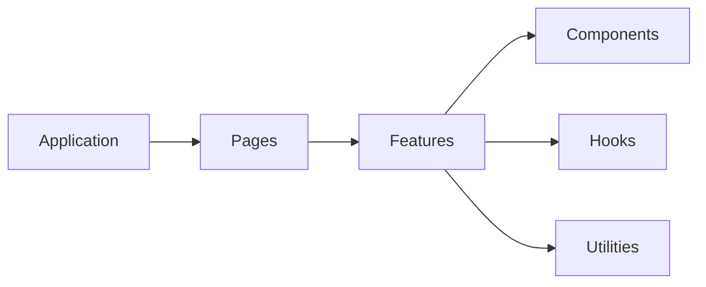

# Hub architecture

## What works now

Hub contributors are rebuilding the app on `build/hub/new` before merging it into `main`. Infrastructure changes use task branches and pull requests targeting that feature branch.

The team has chosen TypeScript, Express for the API, React and Vite for the frontend, and Vitest for tests. The old backend and the frontend code that connected to it have been removed rather than rewritten.

The API responds to a health check and provides GitHub authentication and Hub session routes. The frontend displays the sign-in state with light and dark themes. Storybook keeps the existing components and pages available for reuse.

Contributors can use PostgreSQL and Prisma locally or in the devcontainer. The [identity system](identity.md) separates Hub users, external identities, installation membership, authentication-provider configuration, sessions, authorization attempts, security records, and GitHub source-integration credentials. GitHub user authorization and provider-neutral Hub sessions work when user-auth credentials are configured. The [background-job foundation](background-jobs.md) provides PostgreSQL-backed queues and workers without product jobs. Deployment and product APIs have not been built. This app cannot yet evaluate prototype access, find repositories, import Builds, host previews, save product data, or support reviews.

## Backend

API code lives under `server/`. As features are added, route handlers will read requests, call domains, and return responses. The [code conventions](backend-architecture.md) explain repositories, integrations, utilities, domains, and which layers may import others. Put these directories under `server/` when they are needed; do not add empty implementations.

`GET /api/health` returns `{ "status": "ok" }`. Authentication routes start and complete GitHub authorization, restore or revoke Hub sessions, and perform fresh verification. Unknown paths return a JSON 404 response; invalid JSON is rejected before routing. `createApp()` builds the Express app without starting a server. `server/index.ts` composes the authentication runtime and starts the API at a local address.

The [database guide](database.md) defines the multi-file Prisma schema and shared client in integrations. The health route remains a process check, not a database readiness check.

The [Pino integration](logging.md) writes structured application and HTTP logs to stdout. `createApp()` installs request logging and JSON parsing before routes, so new endpoints inherit completion records and server-generated request IDs without explicit logging calls.

The [background-job foundation](background-jobs.md) uses BullMQ with PostgreSQL and separate on-demand and scheduled worker processes. Setup migrates BullMQ's own schema independently of Prisma. Product processors and schedules are not registered yet.

## Frontend

Keep the existing `app/javascript/` layout. Application code starts React and will connect pages to the API. Pages assemble whole screens from typed props. Features combine components for one task. Components are reusable interface elements that do not need to know the larger task.

Imports follow the arrows above. Shared components, hooks, and utilities must not import pages, features, or application code. Keep browser and server code separate. Agree on the API before adding types shared between them.

The frontend displays the GitHub sign-in and session state inside the theme provider. Existing pages and features use ordinary browser links. Their old destinations do not exist in the new API; keeping the interface does not make those features work.

## Other projects

The starter, build action, learning package, and Copilot prototype extension remain separate projects. Canvas and Controls code stays at its existing `app/javascript/` paths so those projects can keep using it. Connecting the canvas to this Hub will require new API routes.
