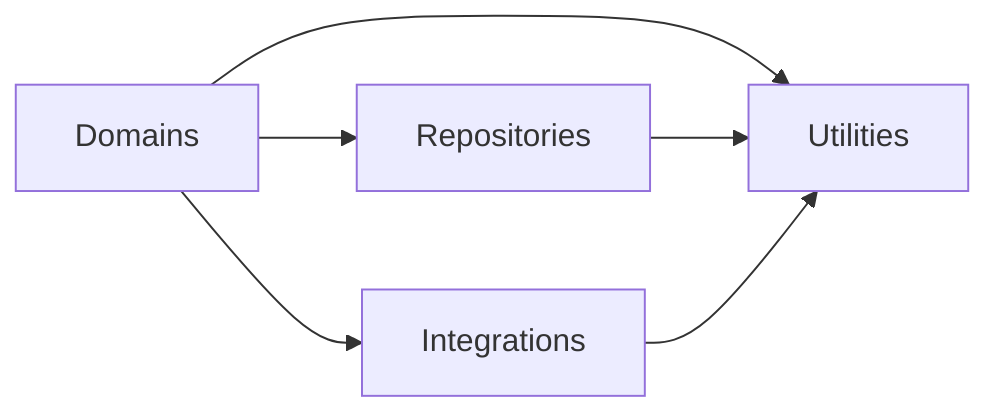

# Code architecture conventions

Organize backend functions into repositories, integrations, utilities, and domains. Each layer has a clear job and rules for which other layers it may use.

| Layer | Responsibility | Directory example |
| --- | --- | --- |
| Repositories | Functions that interact with the database. Each repository directory represents one RESTful resource. | `repositories/user/get-user/index.ts` |
| Integrations | Functions that interact with an API or SDK. Each integration directory represents one API or SDK service. | `integrations/github/get-user/index.ts` |
| Utilities | General functions reusable elsewhere in the codebase. | `utils/format-timestamp/index.ts` |
| Domains | Business logic functions that may compose repositories, integrations, and utilities. | `domains/user/get-user-profile/index.ts` |

## Import boundaries

Repositories and integrations may import only utilities from elsewhere in the backend. Utilities may import only other utilities. Domains may import any of these layers, including other domains. Each layer may also use built-in libraries and npm packages.

These rules apply to imported types as well as functions. A repository must not call another repository or an integration. An integration must not call a repository. Keep business decisions in domains rather than moving them into utilities to get around these rules.

## Directory structure

Put each function in a directory named with lowercase words and hyphens, such as `get-user`. Keep `index.ts`, its tests, and its types together. Group repository functions by resource and integration functions by API or SDK service, as shown above. Import from each function's directory, not from a shared file that re-exports its neighbors.

Add directories when their functions are needed. Do not add empty implementations just to fill out the structure.
