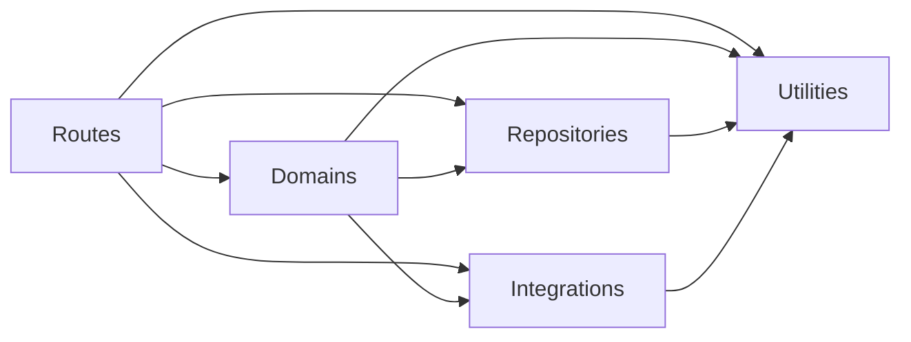

# Code architecture conventions

Organize backend functions into routes, repositories, integrations, utilities, and domains. Each layer has a clear job and rules for which other layers it may use.

| Layer | Responsibility | Directory example |
| --- | --- | --- |
| Routes | Parse HTTP requests, call backend functions, and send responses. Directories follow URL paths and HTTP methods. | `routes/api/health/get/index.ts` |
| Repositories | Functions that interact with the database. Each repository directory represents one RESTful resource. | `repositories/user/get-user/index.ts` |
| Integrations | Functions that interact with an API or SDK. Each integration directory represents one API or SDK service. | `integrations/github/get-user/index.ts` |
| Utilities | General functions reusable elsewhere in the codebase. | `utils/format-timestamp/index.ts` |
| Domains | Business logic functions that may compose repositories, integrations, and utilities. | `domains/user/get-user-profile/index.ts` |

## Import boundaries

Routes may import domains, repositories, integrations, and utilities. Repositories and integrations may import only utilities from elsewhere in the backend. Utilities may import only other utilities. Domains may import any of these backend layers, including other domains, but not routes. Each layer may also use built-in libraries and npm packages.

These rules apply to imported types as well as functions. A repository must not call another repository or an integration. An integration must not call a repository. Keep business decisions in domains rather than moving them into utilities to get around these rules.

## Directory structure

Put each function in a directory named with lowercase words and hyphens, such as `get-user`. Keep `index.ts`, its tests, and its types together. Group repository functions by resource and integration functions by API or SDK service, as shown above. Import from each function's directory, not from a shared file that re-exports its neighbors.

Export route handlers by HTTP method, such as `get()`, and alias them to descriptive `handle*` names in `routes/index.ts`. Its `routes()` function registers endpoints; `createApp()` installs shared middleware and error handling. Express-specific helpers belong in `integrations/express`, not utilities.

Add directories when their functions are needed. Do not add empty implementations just to fill out the structure.

Keep function implementations flat. A composition factory may bind imported functions to dependencies, but must not contain their implementations. Put schemas and constants in a colocated `constants.ts`, and types in `types.ts`.

Keep domain contracts with their domains, GitHub types and errors with that integration, and database inputs with their repositories. Keep only general helpers in utilities.

## Database access

The [shared Prisma client](database.md#shared-client) lives in `server/integrations/prisma/index.ts`. Domains may pass it to repositories for database queries without letting repositories import integrations. Keep model definitions, naming, and migrations consistent with the [database conventions](database.md#schema-conventions).

Compose repository functions in domains. The identity store binds standalone queries to a database client or transaction there; a repository must not import its neighboring queries to build that store.

`staticIdentityStoreRecordId` identifies the row that serializes identity store transactions. It is not a user, provider configuration, or GitHub installation. Keep it with the identity store state repository.

GitHub source credentials use a separate fixed credentials row. Authentication provider configuration must not read or write those credentials.
