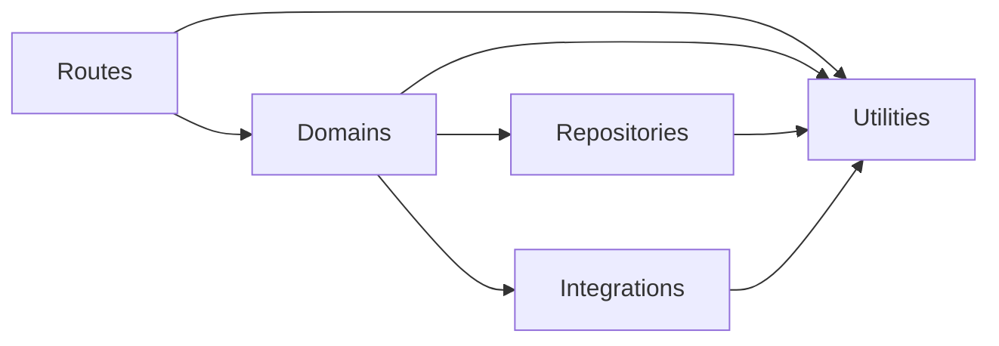

# Code architecture conventions

Organize backend functions into routes, domains, repositories, integrations, and utilities.

| Layer | Responsibility | Directory example |
| --- | --- | --- |
| Routes | Parse HTTP input, call domains, and send responses. | `routes/api/session/get/index.ts` |
| Repositories | Functions that interact with the database. Each repository directory represents one RESTful resource. | `repositories/user/get-user/index.ts` |
| Integrations | Functions that interact with an API or SDK. Each integration directory represents one API or SDK service. | `integrations/github/get-user/index.ts` |
| Utilities | General functions reusable elsewhere in the codebase. | `utils/format-timestamp/index.ts` |
| Domains | Business logic functions that may compose repositories, integrations, and utilities. | `domains/user/get-user-profile/index.ts` |

## Import boundaries

Routes may import domains and utilities. Repositories and integrations may import only utilities from elsewhere in the backend. Utilities may import only other utilities. Domains may import repositories, integrations, utilities, and other domains. Each layer may also use built-in libraries and npm packages.

These rules apply to imported types as well as functions. A repository must not call another repository or an integration. An integration must not call a repository. Keep business decisions in domains rather than moving them into utilities to get around these rules.

## Directory structure

Put each function in a directory named with lowercase words and hyphens, such as `get-user`. Keep `index.ts`, its tests, and its types together. Group repository functions by resource and integration functions by API or SDK service, as shown above. Import from each function's directory, not from a shared file that re-exports its neighbors.

Keep function implementations flat. Extract helpers into their own function directories rather than nesting them in a factory. A composition factory may bind imported functions to dependencies, but must not contain their implementations. Put schemas and constants in a colocated `constants.ts`, and types in `types.ts`.

Add directories when their functions are needed. Do not add empty implementations just to fill out the structure.

## Routes

Mirror the URL below `server/routes/`, then add a directory for the lowercase HTTP method. Use brackets for dynamic path segments. For example, `GET /api/repositories/:owner/:repository/access` lives in `routes/api/repositories/[owner]/[repository]/access/get/index.ts`.

`routes/index.ts` explicitly registers handlers and middleware. It does not implement handlers or discover them dynamically. Shared cookie, CSRF, origin, and error helpers belong in utilities. Inject domain operations into those helpers rather than importing domains from utilities.

## Database access

The [shared Prisma client](database.md#shared-client) lives in `server/integrations/prisma/index.ts`. Domains may pass it to repositories for database queries without letting repositories import integrations. Keep model definitions, naming, and migrations consistent with the [database conventions](database.md#schema-conventions).

Compose repository functions in domains. The identity store binds standalone queries to a database client or transaction there; a repository must not import its neighboring queries to build that store.
