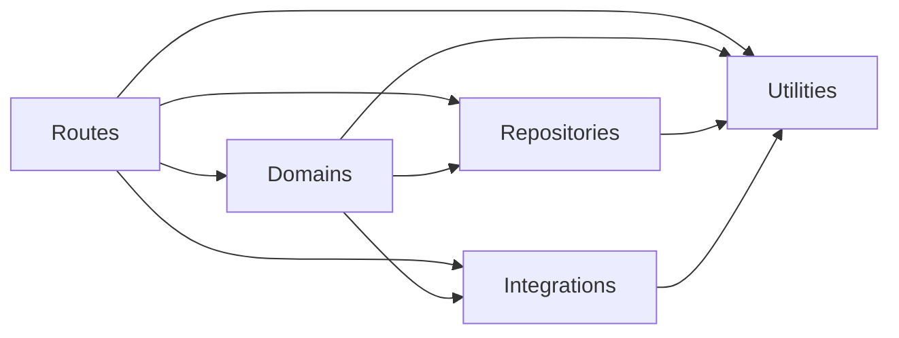

# Code architecture conventions

Organize backend functions into routes, repositories, integrations, utilities, and domains. Each layer has a clear job and rules for which other layers it may use.

| Layer        | Responsibility                                                                                                  | Directory example                        |
| ------------ | --------------------------------------------------------------------------------------------------------------- | ---------------------------------------- |
| Routes       | Parse HTTP requests, call backend functions, and send responses. Directories follow URL paths and HTTP methods. | `routes/api/health/get/index.ts`         |
| Repositories | Functions that interact with the database. Each repository directory represents one RESTful resource.           | `repositories/user/get-user/index.ts`    |
| Integrations | Functions that interact with an API or SDK. Each integration directory represents one API or SDK service.       | `integrations/github/get-user/index.ts`  |
| Utilities    | General functions reusable elsewhere in the codebase.                                                           | `utils/format-timestamp/index.ts`        |
| Domains      | Business logic functions that may compose repositories, integrations, and utilities.                            | `domains/user/get-user-profile/index.ts` |

## Import boundaries

Routes may import domains, repositories, integrations, and utilities. Repositories and integrations may import only utilities from elsewhere in the backend. Utilities may import only other utilities. Domains may import any of these backend layers, including other domains, but not routes. Each layer may also use built-in libraries and npm packages.

These rules apply to imported types as well as functions. A repository must not call another repository or an integration. An integration must not call a repository. Keep business decisions in domains rather than moving them into utilities to get around these rules.

SDK- and framework-specific behavior belongs in its integration, including error classification and runtime adapters. Audit the complete diff for layer placement rather than checking only newly created directories.

## Directory structure

Put each function in a directory named with lowercase words and hyphens, such as `get-user`. Keep `index.ts`, its tests, and its types together. Group repository functions by resource and integration functions by API or SDK service, as shown above. Import from each function's directory, not from a shared file that re-exports its neighbors.

Export route handlers by HTTP method, such as `get()`, and alias them to descriptive `handle*` names in `routes/index.ts`. Its `routes()` function registers endpoints; `createApp()` installs shared middleware and error handling. Express-specific helpers belong in `integrations/express`, not utilities.

Add directories when their functions are needed. Do not add empty implementations just to fill out the structure.

Operational entry points belong under `server/scripts/`. They may compose backend functions and run deployment tools, but routes and domains must not import them. Setup runs separately from the API and workers.

Runtime composition belongs at the narrowest layer allowed to assemble its dependencies. Use a dynamic import only when it preserves a demonstrated lazy-load or optional-dependency boundary, and cover that boundary with a focused test. Avoid pass-through factory chains and unclassified root composition helpers.

Disabled optional features must not initialize their integrations. Reject partial configuration explicitly. When startup reconciles several configured integrations with durable state, commit the reconciliation atomically; removing an integration must also remove retained behavior or authority that depends on it.

Server imports must resolve through native Node.js, the TypeScript compiler, production output, and tests. Add an alias only with one end-to-end resolution contract for all four; otherwise follow the explicit relative ESM convention in [Hub coding conventions](coding-conventions.md#typescript).

Middleware exclusions must match Express path and case semantics so aliases cannot move parsing ahead of origin, size, rate-limit, or other security checks.

## Database access

The [shared Prisma client](database.md#shared-client) lives in `server/integrations/prisma/index.ts`. Domains may pass it to repositories for database queries without letting repositories import integrations. Keep model definitions, naming, and migrations consistent with the [database conventions](database.md#schema-conventions).

## Identity transactions

The identity kernel keeps database access in focused repositories for users, external identities, authentication provider revisions, and security audits. Its domain operations accept transaction-scoped repository functions rather than a mutable store or a global lock.

Keep network, provider, and filesystem work outside the transaction. Provider validation returns canonical public configuration, and the kernel computes and stores only its digest. A transaction may change one identity or authentication-provider aggregate and write its success audit.

After an asynchronous wait or lock acquisition, reread expiry, revocation, and current authority before returning success. Locking serializes database writes but does not order evidence produced outside the transaction. Externally issued authority evidence must carry a durable monotonic ordering marker, including removal evidence, so a delayed callback cannot restore older authority.

The identity kernel owns one fixed bounded retry count and backoff for expected serialization and aggregate-creation conflicts around the complete transaction. Consumers cannot configure or disable this policy. Do not retry invariant or foreign-key failures. Write a database denial or failure audit only after the rejected state transaction has rolled back and the operation has reached its terminal result. When accepted provider evidence must revoke authority but leaves admission denied, commit the revocation, its success audits, session termination, and the admission-denied audit together; this is a successful authority transition with no admitted session. Write a typed provider-validation failure audit after external validation rejects and before returning the safe kernel error.
