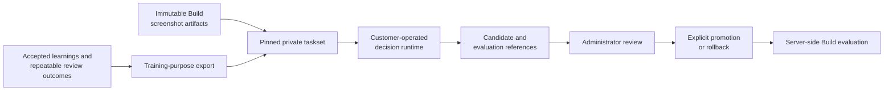

# Decision-model control plane

Hub provides the backend contracts for customer-specific decision-model training, review, promotion, rollback, and Build evaluation. The model runtime stays on customer-operated infrastructure. Hub stores references, digests, decisions, and usage metadata, not taskset contents, credentials, adapters, reports, or model weights.

The control plane is not enabled by default. Runtime composition must supply the adapter that turns stored Build screenshot artifacts into the decision Builds contract and the learning-package taskset preparation source before the API and workers are registered. The runtime taskset upload and cancellation contract matches the work proposed in #297 and must be aligned to its final merged base before publication.

## Flow



1. A Hub administrator enables a repository and sets bounded updates, wall time, backend, and monthly credits.
2. Hub prepares a training-purpose export from accepted learnings and a complete repeatable review snapshot.
3. Hub reads the repository's immutable Build screenshot boundary, creates a private taskset, and pins the consent grant, export, review snapshot, Build set, question set, and taskset digests.
4. Hub atomically reserves the repository's remaining monthly credits, transfers the taskset through the runtime client, submits one idempotent job with that credit limit, and polls it through BullMQ with a fixed delay and deadline.
5. Hub stores the runtime job ID, candidate ID, evaluation digests, eligibility, and usage or cost metadata. Model artifacts remain in the customer runtime.
6. A Hub administrator reviews a candidate and explicitly promotes it or restores the previous candidate. Hub and the runtime both reject a stale promotion generation.
7. Build evaluation sends server-prepared screenshots and questions to the runtime. Hub saves the result only when the runtime used the candidate and generation that Hub recorded as promoted.

## Access

Repository roles are not modeled yet. The control plane uses current live Hub administrator authority and keeps that decision behind `DecisionModelAuthorization`. A later repository-role implementation replaces this adapter without changing training, promotion, or evaluation domains.

The administrator API is:

| HTTP interface | Result |
| --- | --- |
| `GET /api/repositories/:repositoryId/decision-model` | Returns settings, recent jobs, candidates, and the current promotion |
| `PATCH /api/repositories/:repositoryId/decision-model` | Enables or disables the repository and updates bounded settings |
| `POST /api/repositories/:repositoryId/decision-model/training-jobs` | Creates or reuses one training request using the required idempotency key |
| `GET /api/repositories/:repositoryId/decision-model/training-jobs/:jobId` | Returns the persisted job state |
| `POST /api/repositories/:repositoryId/decision-model/training-jobs/:jobId/cancel` | Cancels queued or runtime work |
| `POST /api/repositories/:repositoryId/decision-model/candidates/:candidateId/promotion` | Promotes one reviewed candidate at an observed generation |
| `POST /api/repositories/:repositoryId/decision-model/candidates/:candidateId/rejection` | Persists an administrator's rejection of an unpromoted candidate |
| `POST /api/repositories/:repositoryId/decision-model/rollback` | Restores the previous candidate as a new generation |
| `POST /api/repositories/:repositoryId/decision-model/builds/:buildId/evaluation` | Evaluates one Build through the promoted candidate |

Every mutation requires the application origin and a live administrator session. Candidate promotion and rollback write typed security audits without storing taskset content, learning text, screenshots, runtime credentials, or model artifacts.

The overview's preflight section reports only counts and warnings produced by the configured taskset source: covered prototypes, Builds, screenshots, questions, and labeled samples. Hub does not infer missing coverage. Candidate records retain the runtime's absolute baseline and candidate held-out reward and calibration, their deltas, and per-learning balanced-accuracy changes. Missing runtime metrics remain `null`; Hub labels a per-learning change as a gain, regression, unchanged result, or unknown only from the two reported values.

Candidate duration comes from the runtime job's start and completion times. Usage and cost come from the runtime usage contract. Missing runtime values remain unknown. A rejection records the administrator membership, reason, and time and prevents later promotion or rollback to that candidate. The overview lists promotion history and marks rollback available only when the current promotion names a previous candidate that has not been rejected.

Promotion, rollback, and rejection share one Hub decision-control lock. Runtime work remains outside Prisma transactions, but loss of the lock connection aborts the runtime request before Hub persists a decision. This prevents a concurrent rejection from racing a promotion into inconsistent Hub and runtime state.

Saved Build evaluations list the persisted page-level findings. Each finding names the learning, route, and the viewport and theme combinations evaluated together, plus the runtime candidate and promotion generation and the Hub save time. Hub does not claim that a page-level probability came from one particular screenshot.

## Runtime connection

`readDecisionRuntimeConfiguration()` accepts one explicit HTTPS base URL and one credential provider. The environment-token provider is the first local and compatibility implementation:

```sh
REPLICA_DECISION_RUNTIME_URL=https://decision-runtime.example
REPLICA_DECISION_RUNTIME_AUTHENTICATION=environment-token
REPLICA_DECISION_RUNTIME_TOKEN=<secret>
```

Hub hashes the public URL and provider selection for configuration identity. It never includes the token in that digest or writes it to PostgreSQL, BullMQ payloads, taskset bytes, logs, traces, or API responses. Each runtime request asks the provider for a short-lived operation credential.

The runtime client requires bounded JSON responses and typed errors. It uses these authenticated interfaces:

| HTTP interface | Purpose |
| --- | --- |
| `PUT /v1/tasksets/:digest` | Transfers one immutable private taskset upload bundle |
| `POST /v1/jobs` | Submits bounded training with an idempotency key |
| `GET /v1/jobs/:id` | Reads queued, running, or terminal state |
| `POST /v1/jobs/:id/cancel` | Records durable cancellation |
| `GET /v1/candidates/:id` | Reads immutable candidate and evaluation references |
| `GET /v1/promotion` | Reads the runtime promotion generation |
| `POST /v1/promotions` | Promotes a candidate |
| `POST /v1/rollbacks` | Restores the previous candidate |
| `POST /v1/evaluations` | Evaluates server-prepared Build screenshots |

The transfer and cancellation interfaces are narrow Hub transport additions to the reference runtime lifecycle. The runtime must also enforce the submitted credit limit, return candidate usage and cost when known, and support generation-checked promotion decisions before those fields can be authoritative end to end. Hub preserves missing runtime values as unknown.

## Persistence

Prisma owns repository settings, training jobs, candidate references, promotion history, and Build evaluation references. Database checks preserve cross-writer bounds and usage or cost field pairing.

Hub does not persist:

- Runtime bearer tokens or provider secrets.
- Training exports, tasksets, screenshots, adapters, reports, or weights.
- Provider-specific compute, storage, scheduler, or deployment fields.

Training and inference usage accept a decimal quantity and unit plus an optional decimal cost and ISO currency. Missing usage remains unknown rather than becoming zero.

## Workers and recovery

`decision.training` runs on the on-demand queue. One job can poll for up to 24 hours with five-minute retry spacing, while the repository's own `maxSeconds` plus a five-minute completion window is the stricter domain deadline. Runtime rate limits, timeouts, and availability failures retry. Invalid responses, authorization failures, digest drift, stale settings, and invariant failures stop. Terminal state changes and their security audits commit together, and conditional transitions prevent cancellation or a delayed worker from replacing an existing terminal result.

`decision.recover-training` lists active PostgreSQL records and re-enqueues each stable job ID. Runtime composition must register this processor and its schedule when it supplies the taskset and Build artifact sources. This preserves the existing rule that Prisma writes and BullMQ enqueueing are not one transaction.

## Non-goals

This layer does not add the Learnings page UI, Azure decision-runtime connectors, automatic promotion, pooled GPUs, multi-region scheduling, browser capture controls, or model artifact storage in Hub.
