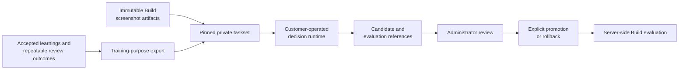

# Decision-model control plane

Hub provides the backend contracts for customer-specific decision-model training, review, promotion, rollback, and Build evaluation. The model runtime stays on customer-operated infrastructure. Hub stores references, digests, decisions, and usage metadata, not taskset contents, credentials, adapters, reports, or model weights.

The control plane is not enabled by default. Configuring the decision runtime registers the API and workers only when Hub also has private learning storage and provider-neutral artifact storage. The runtime client uses the merged taskset upload, cancellation, hard-credit-budget, authoritative usage, and generation-checked promotion contracts.

## Flow



1. A repository administrator reads an authoritative preflight with eligible prototype, Build, page, screenshot, question, split, label, and withheld-evidence counts, then enables a repository and sets bounded updates, wall time, backend, and monthly credits.
2. Hub prepares a training-purpose export from accepted learnings and a complete repeatable review snapshot.
3. Hub reads the repository's immutable Build screenshot boundary, creates a private taskset, and pins the consent grant, export, review snapshot, Build set, question set, and taskset digests.
4. Hub atomically reserves the repository's remaining monthly credits, transfers the taskset through the runtime client, submits one idempotent job with that credit limit, and polls it through BullMQ with a fixed delay and deadline.
5. Hub stores the runtime job ID, candidate ID, evaluation digests, eligibility, and usage or cost metadata. Model artifacts remain in the customer runtime.
6. A repository administrator reviews a candidate and explicitly promotes it or restores the previous candidate. Hub and the runtime both reject a stale promotion generation.
7. Build evaluation sends server-prepared screenshots and questions to the runtime. Hub saves the result only when the runtime used the candidate and generation that Hub recorded as promoted. The saved summary binds each learning ID and Build-wide probability pair to the exact routes, viewports, and themes that Hub sent, with a Hub-generated explanation.

## Taskset source

Hub selects active registered prototypes that have review threads, then selects their successful Builds with a publication time. It orders each prototype's Builds by workflow creation time and Build number. Removed repositories, deleted or unregistered prototypes, unsuccessful or unpublished Builds, and records from another repository never enter the source.

The source reads `templates.json` and PNG screenshots through the configured artifact-storage contract. It maps the root and each declared template to the exact route captured by the build action, with desktop and narrow viewports in light and dark themes. The private Build-set snapshot pins each image's SHA-256 digest, media type, route, viewport, and theme. A missing, unavailable, oversized, malformed, or incomplete set is an explicit preparation failure; Hub does not turn partial coverage into a successful training request.

Training preparation takes the PostgreSQL learning-operation lock, imports one repeatable complete review snapshot under an active training-purpose grant, and exports only currently accepted and permitted evidence. It normalizes volatile export and taskset transport metadata so an unchanged request reproduces the same pinned digests. The learning package still owns question generation, review-outcome labels, and prototype-level train, development, and test splitting.

Hub stages export, Build, screenshot, and taskset files in mode-0700 temporary directories, enforces fixed file, byte, prototype, Build, and screenshot bounds, creates a deterministic private taskset archive, and removes staging on success or failure. The worker regenerates every pinned input before transfer, refuses drift, verifies the runtime's stored taskset digest, and uses stable taskset and training idempotency keys.

The repository overview and retryable training preparation use temporary learning exports in preview mode. They do not create export records or consent-withdrawal follow-ups for files that Hub deletes after preparation. The durable training job owns the consent grant and pinned export digest for the runtime copy. Preflight counts eligible prototypes, Builds, pages, screenshots, questions, tasks, train/development/test assignments, and follows/breaks labels. It reports sorted reason codes and counts for withheld consent, missing or corrupt artifacts, unavailable storage, incomplete screenshot coverage, and incomplete review evidence. It does not return learning text, comment text, screenshot bytes, artifact keys, or cross-repository identifiers.

Completed Build evaluations remain owned by `DecisionBuildEvaluation`; Hub does not add a second evaluation store. Its bounded JSON summary keeps learning IDs, exact captured views, probabilities, and explanations generated by Hub from those probabilities. The decision-model overview projects those findings with the Build, candidate, promotion generation, digests, and evaluation timestamp. Learning text remains in the private learning store and is not copied into PostgreSQL.

## Access

The control plane uses current repository-administrator authority and keeps that decision behind `DecisionModelAuthorization`. Each read and mutation checks the live membership, connected repository, and administrator-level repository grant.

The administrator API is:

| HTTP interface | Result |
| --- | --- |
| `GET /api/repositories/:repositoryId/decision-model` | Returns preflight coverage, settings, recent jobs, candidates, the current promotion, and recent Build evaluation findings |
| `PATCH /api/repositories/:repositoryId/decision-model` | Enables or disables the repository and updates bounded settings |
| `POST /api/repositories/:repositoryId/decision-model/training-jobs` | Creates or reuses one training request using the required idempotency key |
| `GET /api/repositories/:repositoryId/decision-model/training-jobs/:jobId` | Returns the persisted job state |
| `POST /api/repositories/:repositoryId/decision-model/training-jobs/:jobId/cancel` | Cancels queued or runtime work |
| `POST /api/repositories/:repositoryId/decision-model/candidates/:candidateId/promotion` | Promotes one reviewed candidate at an observed generation |
| `POST /api/repositories/:repositoryId/decision-model/candidates/:candidateId/rejection` | Persists an administrator's rejection of an unpromoted candidate |
| `POST /api/repositories/:repositoryId/decision-model/rollback` | Restores the previous candidate as a new generation |
| `POST /api/repositories/:repositoryId/decision-model/builds/:buildId/evaluation` | Evaluates one Build through the promoted candidate |

Every mutation requires the application origin and a live administrator session. Candidate promotion and rollback write typed security audits without storing taskset content, learning text, screenshots, runtime credentials, or model artifacts.

The overview's preflight section reports only counts and warnings produced by the configured taskset source: covered prototypes, Builds, screenshots, questions, and labeled samples. Hub does not infer missing coverage. Candidate records retain the runtime's absolute baseline and candidate held-out reward and calibration, their deltas, and per-learning balanced-accuracy changes. Missing runtime metrics remain `null`; Hub labels a per-learning change as a gain, regression, unchanged result, or unknown only from the two reported values.

Candidate duration comes from the runtime job's start and completion times. Usage and cost remain the runtime's attributed record list, including connector, kind, quantity, unit, cost, currency, source, and metadata. Hub sums only measured `credits` records for monthly budget accounting; it does not combine unrelated units or currencies. Missing runtime values remain unknown. A rejection records the administrator membership, reason, and time and prevents later promotion or rollback to that candidate. The overview lists promotion history and marks rollback available only when the current promotion names a previous candidate that has not been rejected.

Promotion, rollback, and rejection share one Hub decision-control lock. Runtime work remains outside Prisma transactions, but loss of the lock connection aborts the runtime request before Hub persists a decision. This prevents a concurrent rejection from racing a promotion into inconsistent Hub and runtime state.

Saved Build evaluations list the persisted page-level findings. Each finding names the learning, route, and the viewport and theme combinations evaluated together, plus the runtime candidate and promotion generation and the Hub save time. Hub does not claim that a page-level probability came from one particular screenshot.

Training withdrawal is selector-based. Hub records the export, grant, evidence, and taskset identifiers, enumerates content-free copy references from the repository's configured runtime, requests deletion, and persists the durable receipt. Pending and completed revocations block taskset upload, training, promotion, rollback, and evaluation for matching inputs. A scheduled recovery pass polls pending receipts after restart. The overview exposes only safe selectors, state, pending and failure counts, and receipt times; PostgreSQL never stores screenshots, learning text, labels, prompts, adapters, or model bytes from the receipt flow.

## Agent visual critic

The prototype canvas exposes `evaluate_prototype` for an authoring agent to request explicit visual feedback while iterating. The action accepts only bounded PNG captures for named routes and the supported desktop or narrow, light or dark view combinations. Agents capture those images through the isolated browser canvas or the existing Replica Build capture path. The action never sends the user's prompt, Copilot session ID, local preview origin, Hub credential, or runtime credential.

The plugin sends the current checkout branch and commit through its approved repository connection. Hub authorization derives the repository, prototype, and matching Build context from that connection rather than accepting repository IDs from the action. The route is registered only when runtime composition supplies this authorization adapter and the final decision-runtime and learning-authority sources.

`POST /api/canvas/decision-model/evaluations` is the plugin-only interface. It uses the approved Canvas bearer credential rather than a browser session or application-origin proof.

For every request, Hub rereads repository enablement, learning consent and eligibility, runtime readiness, the promoted candidate, and its generation. Production guidance requires a production-ready runtime and a production-eligible promoted candidate. A fixture runtime may return unmistakable fixture findings with `guidance.available: false`; consumers must not use them as production guidance.

Hub hashes the screenshot set, current route, runtime environment, and promoted model identity and reuses a short-lived bounded cache only while those values and the eligible learning digest still match. The cache stores content-free learning IDs and probabilities, not learning text or screenshots; Hub rereads current eligible text, consent, deletion state, and promotion before returning a cached result. Session and repository request limits apply to cached and fresh requests.

Agent inference has a separate monthly request-unit budget of 500 routes per repository. A route consumes one unit when Hub reserves it, including failed or uncertain dispatched work. Cache expiry removes reuse eligibility but never removes consumed units. This quota bounds request volume; it is not presented as runtime credit or cost accounting.

Findings return learning ID and text, route, evaluated views, follows and breaks probabilities, candidate and promotion generation, cache status, and a bounded explanation. The explanation always labels the result as unverified authoring guidance. Evaluation does not change code, publish a Build, promote a model, save a review outcome, or verify improvement.

Agents should use findings to inspect a concrete route and decide what to try next. They must not repeatedly optimize screenshots for a higher score, hide variants that disagree, convert a probability into a product requirement, or claim improvement without a reviewer checking the resulting prototype. Call the action again only after an intentional authoring change or when evaluating another selected route or view set.

## Runtime connection

`readDecisionRuntimeConfiguration()` accepts one explicit HTTPS base URL and one credential provider. Runtime composition selects that connection per repository because each runtime owns one repository-scoped promotion generation. The environment-token provider is the first local and compatibility implementation:

```sh
REPLICA_DECISION_RUNTIME_URL=https://decision-runtime.example
REPLICA_DECISION_RUNTIME_AUTHENTICATION=environment-token
REPLICA_DECISION_RUNTIME_TOKEN=<secret>
REPLICA_DECISION_RUNTIME_ENVIRONMENT=production
```

Hub hashes the public URL, provider selection, and explicit `fixture` or `production` environment for configuration identity. It never includes the token in that digest or writes it to PostgreSQL, BullMQ payloads, taskset bytes, logs, traces, or API responses. Each runtime request asks the provider for a short-lived operation credential. Production guidance is unavailable unless this runtime environment is explicitly `production` and its live promotion matches Hub.

HTTPS remains required by default. A local development process may set `REPLICA_DECISION_RUNTIME_ALLOW_INSECURE_LOOPBACK=true` for an explicit `http://127.0.0.1`, `http://[::1]`, or `http://localhost` runtime. Hub rejects that flag outside development and still rejects plaintext non-loopback URLs.

The runtime client requires bounded JSON responses and typed errors. It uses these authenticated interfaces:

| HTTP interface | Purpose |
| --- | --- |
| `PUT /v1/tasksets/:digest` | Transfers one immutable private taskset upload bundle |
| `POST /v1/jobs` | Submits bounded training with an idempotency key |
| `GET /v1/jobs/:id` | Reads queued, running, or terminal state |
| `POST /v1/jobs/:id/cancel` | Records durable cancellation |
| `GET /v1/candidates/:id` | Reads immutable candidate and evaluation references |
| `GET /v1/promotion` | Reads the runtime promotion generation |
| `POST /v1/promotions` | Promotes a candidate |
| `POST /v1/rollbacks` | Restores the previous candidate |
| `POST /v1/evaluations` | Evaluates server-prepared Build screenshots |
| `GET /v1/runtime-copies` | Enumerates bounded content-free copy references for exact selectors |
| `POST /v1/deletions` | Revokes matching use and returns a durable deletion receipt |
| `GET /v1/deletions/:id` | Reads the content-free receipt for recovery |

The reference runtime validates uploaded tasksets, enforces the submitted hard credit limit, returns attributed training usage and cost, and rejects stale promotion or rollback generations. Hub preserves optional values as unknown rather than inventing them.

## Persistence

Prisma owns repository settings, training jobs, candidate references, promotion history, and Build evaluation references. Database checks preserve cross-writer bounds and usage or cost field pairing.

Hub does not persist:

- Runtime bearer tokens or provider secrets.
- Training exports, tasksets, screenshots, adapters, reports, or weights.
- Provider-specific compute, storage, scheduler, or deployment fields.

Training and inference usage accept a decimal quantity and unit plus an optional decimal cost and ISO currency. Missing usage remains unknown rather than becoming zero.

## Workers and recovery

`decision.training` runs on the on-demand queue. One job can poll for up to 24 hours with five-minute retry spacing, while the repository's own `maxSeconds` plus a five-minute completion window is the stricter domain deadline. Runtime rate limits, timeouts, and availability failures retry. Invalid responses, authorization failures, digest drift, stale settings, and invariant failures stop. Terminal state changes and their security audits commit together, and conditional transitions prevent cancellation or a delayed worker from replacing an existing terminal result.

`decision.recover-training` lists active PostgreSQL records and re-enqueues each stable job ID. Runtime composition registers this processor and its schedule when decision-runtime configuration is present. This preserves the existing rule that Prisma writes and BullMQ enqueueing are not one transaction.

## Frontend boundary

The Learnings page exposes the existing control-plane overview and mutations to current Hub administrators with repository access. It supports bounded repository settings, preflight evidence coverage and blockers, explicit training confirmation, job cancellation, candidate comparison and rejection, promotion, rollback, and saved Build findings. It never promotes automatically and identifies the deterministic fixture backend as non-production contract evidence.

Candidate review includes absolute baseline and candidate metrics, their changes, per-learning gains or regressions, duration, usage and cost. Build findings identify the accepted learning, route, captured viewport and theme, and link back to the evaluated Build. Legacy evaluation summaries that predate structured findings remain visibly unavailable rather than being inferred.

## Non-goals

This layer does not add Azure decision-runtime connectors, automatic promotion, pooled GPUs, multi-region scheduling, browser capture controls, reviewer-confirmation collection, or model artifact storage in Hub.
