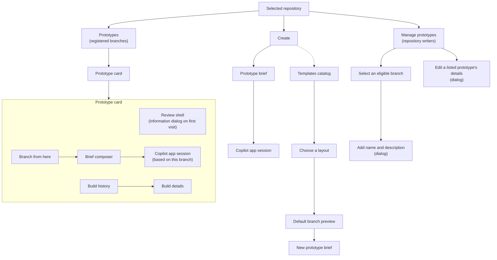

# Gallery

The gallery is where reviewers browse connected repositories and registered prototype branches. Hub still discovers Builds for unlisted branches, but shows their cards only after a repository writer adds them to Hub.

In the GitHub-backed flow, Hub checks the reviewer's current GitHub access before showing any repository or Build. [Development-only local mode](local-development.md) uses its local identity instead.

After sign-in, Hub selects the first accessible repository by name. The repository selector includes only active repositories already connected to Hub that the current user may read. It switches the workspace without returning to a separate repository list.

Sidebar destinations, including Prototypes and Create, use the same in-app navigation as gallery cards. They remain ordinary links for keyboard activation and modified clicks that open another tab or window. Each navigation still requests current page data from Rails; it does not reuse a cached page.

## Welcome

**Welcome** appears immediately below the repository selector in the sidebar. It opens `/welcome`, with a full-width introduction video card and three action cards linking to the README, the [getting started guide](../../docs/getting-started.md), and **Create prototype** for the selected repository. Each card has a headline and description. The action cards share a row on wider screens and stack on smaller screens. Without a repository or in local mode, the third card explains that creation requires a connected GitHub repository instead of offering an action. The guide helps authors join their organization's prototyping environment, create and publish prototypes, share feedback, and add controls.

The video card shows a large native player with its heading and description underneath. The video plays only when the person starts it and uses the browser's playback controls. **Getting started** opens the walkthrough, while **Create prototype** opens the selected repository's **Create** page. If the video is not configured or cannot load, the page explains that and keeps the cards available.

Opening Welcome from a repository and hiding its sidebar link preserve that selected repository, including the **Create prototype** destination. Repository context is retained only while the signed-in person can read that repository.

New accounts open Welcome after their first successful sign-in. Later sign-ins and accounts that existed before this feature keep their normal destination. A pending preview or canvas authorization takes precedence over Welcome and consumes that first-sign-in opportunity without interrupting the requested task.

**Hide welcome** removes only the signed-in person's sidebar link across repositories, browsers, and devices. It leaves them on Welcome with a confirmation. The preference survives sign-out and later sign-ins, and `/welcome` remains available to signed-in users. This version has no restore control. Welcome does not require a readable repository; its sidebar shows only independently authorized repository and administration links.

Operators configure the video through the [deployment settings](deployment.md#welcome-video).

## Browse prototypes

Prototypes appear in pages of up to 24, newest registration first. Numbered navigation with **Previous** and **Next** uses the same Primer Brand pagination component as Manage prototypes and keeps the current search and author filter. Hub loads card and Build data only for the selected page. New registrations or removals can shift records between pages while browsing.

The header groups the Author dropdown beside search, followed by the gallery/list controls. On narrow screens, these controls stack in that order, keeping filtering separate from presentation.

Search matches prototype names, descriptions, branches, and registration authors across the full selected repository, not only the visible page. Search treats punctuation such as `%` and `_` literally. SQLite's built-in matching ignores ASCII letter case; non-ASCII letters retain SQLite's case behavior. The count shows all matches, with the number shown on the current page when fewer are displayed.

The **Author** dropdown puts **Me** first, followed by **All authors** and searchable pages of the repository's registration authors. Long labels and options truncate with an ellipsis rather than widening the dropdown or scrolling horizontally; hovering reveals their full text. **Me** uses the signed-in person's saved identity. Cards and the list's **Author** column show the first person who added the prototype to Hub; later commits by another person do not change attribution or author-filter results. Prototypes without a saved author remain visible with no author filter and display **Author unavailable**. Local mode keeps its existing local-identity presentation and applies author filters to saved registration authors.

Search and author filters combine. Applying either starts again at the newest matching page. Choose **All authors** to remove the author filter. The URL preserves applied search, author, and page state across reloads and browser history. Switching repositories starts without those filters. Author choices load in bounded pages and are not restricted to authors on the visible prototype page; **More** loads the next page of authors. Clearing or changing author-option search starts its choices from the beginning. An empty author collection leaves the pinned options available without an empty-state message; a search with no matches shows **No matching authors**.

While Hub fetches results, it keeps the previous cards visible and announces the update. A failed request keeps those cards with an explicit error and **Retry**. No matches has its own empty state, separate from a repository with no prototypes. A page beyond the remaining results shows the last available page.

An empty Prototypes page shows a branch Octicon, a heading, and guidance. For GitHub repositories, **Build prototype** opens **Create**. Local repositories keep their branch-discovery guidance without offering the Copilot app flow.

The **Create** sidebar link opens a centered brief composer for the selected repository, with **What should we create?** above it and the **Templates** catalog below. Choose a template inside the composer before **Add details**, or open a catalog card to preview it first. The picker starts with **Default**. Choosing another template includes its quoted route, query, and fragment in the prompt and instructs the agent to set it as the new prototype's landing page through `startPage` in `.prototype`. Choosing Default removes that extra context. Catalog search does not change the selected template, brief, or saved details. Unavailable or corrupt template metadata returns an explicit service failure rather than an incomplete collection.

People can add optional context about what should change, who the prototype serves, and what it should let them do. The details button changes from **Add details** with a plus to **Edit details** with a pencil after saving any nonblank detail. Unsaved or canceled edits do not change it; saving only blank details restores **Add details**. On submission, Hub prepares a Copilot app deep link with the selected repository, the brief, and prototype-creation instructions. The **Continue in Copilot app** dialog explains that an agent will work on the plan and that the app must be installed on this device, with a download link. **Open Copilot App** opens GitHub's HTTPS launcher in a new tab without leaving Hub; there is no countdown or automatic launch. Reviewers can also copy the complete prompt. The top-right close button or Escape returns to the saved brief. Hub does not create a branch or session itself; the Copilot app handles that after opening.

Local repositories also offer **Create**, with the same template picker, catalog, and optional details. Its **Copy prompt** action copies the brief, selected template context, and instructions to create a new branch from the default branch. Hub reports clipboard success or failure and never launches Copilot for a local repository. Paste the prompt into an agent session in that local repository. The existing local prototype-review branching behavior remains unchanged.

## Templates

The **Templates** catalog on **Create** lists the selected repository's latest successful default-branch Build. Its heading is on the left, with the count and search on the right. Search matches template names, categories, and descriptions; the count reflects the results. **Default** always appears and opens the repository root at `/`. Additional templates come from the optional `templates.json` manifest retained with that Build. Each card shows its own desktop screenshot, title, and description. The entire card opens its declared path, query, and fragment. Categories remain searchable metadata but are not displayed. Repositories without a manifest show Default and explain that there are no additional templates.

The centered catalog has a maximum width 1.3 times the form's maximum width. It shows three cards per row on desktop, two at intermediate widths, and one on narrow screens. Screenshots use the same full-height preview as Prototypes: hover or focus to scroll tall images, or scroll manually on touch devices and with reduced motion enabled.

There is no separate Templates listing or sidebar destination. The old `/repositories/:id/templates` listing redirects to **Create** after checking repository access. Template detail routes remain available, select **Create** in the sidebar, and return there when closed.

Hub reads the manifest, routes, and screenshots from one stored Build, not a live checkout. Templates and template previews keep the previous successful snapshot without a build alert while a newer default-branch Build is pending or unsuccessful. Reload after the new Build succeeds to see its templates. Without a successful Build, Default remains available with an unavailable screenshot, and its detail explains why no preview is available. Renaming the default branch switches Templates to that branch; Hub does not reuse the old branch's preview. Corrupt or unavailable retained metadata returns an explicit service failure, not an empty collection.

Template details use the same isolated preview host and current repository read-access check as prototype previews. **Controls** in the header opens the existing Build Controls panel for changing app state in the viewer's own preview, including Default and local repositories. The Build must contain a compatible controls connection; unsupported Builds show the panel's existing explanation. Control values follow the same URL-backed behavior as prototype previews and do not change retained Build files or saved prototype settings. Template details have no information dialog, start-page setting, Build selector, comments, history, registration, public shares, or canvas metadata controls. A default-branch Build is not a prototype and does not appear in Prototypes or the canvas. The legacy `/repositories/:id/replica` URL still opens Default, with Create selected in the sidebar. Switching templates resets the preview's reported route and brief.

The browser URL and copied **Prototype link** follow the preview's path, query, and fragment. Reopening either link returns to that page on the latest successful default-branch Build, not a pinned snapshot. An explicit local `return_path` takes precedence over the selected template's initial route, including Default's `/`. Invalid return paths return not found. Template details ignore incoming Build and history parameters and remove them from the browser URL. **Minimize Hub UI** fills the viewport with the same preview frame without reloading it. It hides navigation, the header, the address bar, and the brief composer. The draggable bar keeps its drag handle, **Controls**, and **Maximize Hub UI**, with no comment controls. A copied minimized link includes `view=minimized` and reopens at the saved route on the latest successful default-branch Build. Maximizing restores the same template detail, controls panel state, and any composer draft. Without a successful Build, template details cannot minimize or offer Controls.

The header's **Branch from here** icon button focuses the bottom **What changes would you like to make?** composer, expanding it if needed without submitting or clearing a draft. It is available on Default and other template details, including in local mode. The composer starts a new prototype through the same Copilot app continuation used by **Create**. Its prompt tells Copilot to create a new prototype branch from the repository's default branch, never to change that default branch. It does not branch from the preview's older commit. In local mode, the same composer copies the brief and branch instructions instead of opening the Copilot app. Both prompts include the page being viewed when you submit, using the preview's latest reported path, query, and fragment. Before the preview reports navigation, Hub uses the selected template's initial destination. Hub quotes the route as data and omits preview hosts and authorization URLs. The Default composer remains available without a successful Build, but then adds no page context. Empty briefs cannot submit. Hub confirms a successful copy or reports a clipboard error so you can retry; it does not create a branch or session.

For a non-Default template, both prompts also instruct the agent to make the currently viewed valid route the new prototype's landing page through `startPage` in the repository-root `.prototype` JSON file. Before navigation, or if a reported route is invalid, the prompt uses the detail's initial preview destination, including an explicit `return_path` from a reopened link. It preserves the query and fragment, quotes the route as data, and changes only the new branch. Default keeps the existing Browse behavior without this landing-page instruction.

## Add a prototype to the gallery

Hub discovers non-default branches without assuming they are prototypes. The gallery shows a separate alert for each eligible, unlisted branch the current person pushed within the past 12 hours. Each alert identifies the branch and offers **Add to Hub**, which registers it immediately with its branch name as its title and returns to the gallery. The less prominent **Hide message** action permanently hides that branch's alert for the signed-in person who clicks it, including after later pushes, reloads, and sign-ins. It does not hide anyone else's alerts or change discovery, Builds, or registration. The branch remains available through **Manage prototypes**. Local branch alerts use the same saved preference for the local identity. If another writer has already added the branch, submitting an older alert leaves its saved details and first author unchanged. Writers can edit its title and description afterward through the gear beside **Prototypes**.

Hub uses GitHub's repository activity timestamps and actor identity, not commit author dates or the time Hub discovered a Build. Pushes, force pushes, and branch creation count; merges and branch deletion do not. Hub reads all activity pages for the current person over the last day and applies the 12-hour cutoff on each page request. Alerts disappear after that window, but older eligible branches remain available through the gear.

Local checkouts have no GitHub push history. For the local identity, the same alerts instead say that Hub detected a branch locally. Hub saves the time it first observes a branch head and updates that time only when the observed head changes, including a reset to a previously built commit. Unchanged heads keep their age across scans, reloads, and restarts. Existing local branches receive their first observation on the next scan after upgrading. These alerts also expire after 12 hours and exclude registered or deleted branches. Commit dates and Build completion times do not determine local activity.

The management page opens after Hub checks access to the selected repository. Listed prototypes are available for editing while eligible branches and other repository choices load independently. Each section shows its loading state and offers a retry if its check fails; one failure does not block the other section.

Hub lists eligible branches ten per page. Page numbers reflect branches the current person can add, so ineligible branches do not leave empty pages. A repository admin can select any current, non-default branch except `replica/install-workflow`. Other people need current repository write access and a commit linked to their GitHub account that is unique to the branch relative to the default branch. Hub checks the full branch-only commit history, not just the latest Build. Deleted branches and branches not yet discovered by Hub cannot be added. A requested page that no longer exists reports a failed branch check instead of an empty list. The server checks eligibility again when the form is submitted; a failed GitHub check does not grant access. Local mode's one identity is an admin and does not call GitHub.

Select a branch, enter a name, optional description, and optional **Start page** in the dialog, then choose **Add to Hub**. The branch appears as a card for everyone with repository read access. Hub records the first person to add it as its author; later edits do not change that attribution. Any current repository writer can edit the same fields for a listed prototype, even if they did not author it. If Hub cannot check branch eligibility, the gallery and management page still show registered prototypes and a warning. Editing remains available, but adding branches waits until the check succeeds.

**Start page** accepts a route such as `/settings?tab=profile#details` or a signed-in or public preview URL for a Build of this prototype. Hub saves only the path, query, and fragment, so the same setting works across Build hosts. Unrelated URLs, credentials, parent-directory segments, and reserved `/__replica` routes are rejected. Clear the field to start at `/`. Hub does not check whether the route exists; changing this setting does not regenerate screenshots.

Before Hub has a setting, it imports `startPage` from the repository-root `.prototype` JSON file at the discovered commit. The file contains only this field; legacy fields are ignored. Missing files leave the default at `/` and allow a later commit to supply it. Invalid files show a warning in the metadata dialog and can be corrected in a later commit; they do not fail the Build or register the prototype. In local mode, a branch whose commit is already on the default branch has no file of its own yet, because agents often create the branch before committing. Hub treats its file as missing, so the branch's first commit of its own supplies the start page instead of the default branch's.

Once imported or explicitly saved in Hub, the setting belongs to Hub. Future pushes do not read or overwrite it, including when someone clears it to `/`. Editing only a name or description does not claim an unset start page. Existing registered prototypes retain their current settings when upgrading, including blank defaults. Keep `.prototype` in Git for local use and new branches.

The saved start page applies when opening review, standalone previews, public shares, and connected local canvases, including older Builds. An explicit destination takes precedence. Saving metadata does not navigate an already-open preview. See [Preview serving](preview-serving.md) and [Prototype canvas](prototype-canvas.md) for those entry points.

When an existing Hub adopts registration, previously discovered branches start unlisted. A writer must add each prototype to the gallery; its Build history remains available through direct links in the meantime.

Unlisted branches do not appear in the gallery for readers, but registration is not an access restriction: a reader who already has an exact Hub URL can still open that Prototype's Builds and previews. The existing workflow also continues building non-default branches. A name and description do not imply that a Build succeeded; the list shows the latest Build state.

Confirmed GitHub branch deletion retires its Prototype from the gallery and registered management list. It preserves registration and retained review data, including direct links and public shares. A reused branch name resumes only the latest retired Prototype whose saved head is contained in the new head; otherwise it starts a separate unregistered history. Merging or closing a pull request alone changes nothing, and local-mode behavior is unchanged. See [Build discovery](build-discovery.md#matching-builds) for the ancestry rule and observation limits.

Local repositories omit workflow installation. Hub checks committed local branches once a minute and builds branches that have not been added to the gallery; the local identity can add them through their recent-branch alerts or **Manage prototypes** after discovery. The local developer has a distinct avatar throughout Hub.

## Pages

| Page              | What reviewers see                                                                    |
| ----------------- | ------------------------------------------------------------------------------------- |
| Prototypes        | Registered branches in a gallery or list; the list shows owner and latest Build state |
| Manage prototypes | Eligible unlisted branches and editable details for listed prototypes                 |
| Create            | Brief composer and searchable default-branch templates; local mode copies the prompt  |
| Template detail   | Selected layout's actual Build preview and a new prototype composer                    |
| Prototype         | The selected Build inside the review shell                                            |
| Build history     | Every recorded Build, newest first                                                    |
| Build details     | Commit, workflow, failure details, screenshots, and preview link                      |

The Prototypes page orders prototypes by when they were first added to Hub, newest first. New prototypes appear at the top left of the gallery and at the top of the list. Editing details or publishing another Build does not change that order.

Command K (or Control K) focuses the Prototypes search field. Clearing search keeps the selected author.

Opening a prototype from its card or list row uses in-app navigation rather than reloading the document. List links use normal text colors without underlines. Hovering or focusing an owner's profile link underlines the name; selecting it opens that profile instead of the prototype. The **passing** and **not passing** badges use lowercase text and have no icons. The review shell opens the latest successful Build. Its controls stay above the rounded preview.
Gallery cards and Build details show the top of each full-height screenshot in a fixed preview. Hovering a preview scrolls through the remaining image; on touch devices or with reduced motion enabled, scroll the preview manually. In those modes, list screenshots remain manual scroll areas while the rest of each row opens the prototype. Older viewport-height screenshots stay at the top without scrolling.

Gallery cards, Build details, template cards and template-picker thumbnails select the retained light or dark screenshot to match Hub's resolved theme, including an explicit theme choice. Older Builds without dark captures use their existing screenshot in either theme; successful Builds are not recaptured. Capture behavior and limits are defined in [GitHub Actions builds](github-actions-builds.md#uploaded-artifact).

The prototype name links to the selected review Build. The bar above the iframe shows its Hub link with copy and **Minimize Hub UI** controls. It follows navigation reported by the review bridge. If the bridge is unavailable, the link keeps the Build's initial destination. The More actions menu contains Share links (when available), History, and Build details.

The prototype detail automatically opens its information dialog only on your first visit to that prototype. Hub remembers this for your account across browsers, sign-ins, and Builds after successfully rendering the page. Simultaneous first visits claim the introduction atomically, so only one opens it. A failed render or a minimized link does not use up that first visit. The dialog shows the registered title or branch name and the Build author's identity. A nonblank description appears without surrounding quotes; an empty description omits both the text and its heading. Dismissing it exposes the preview and focuses it when no previous control needs focus restored; moving the pointer into the preview also focuses it so the embedded page can scroll without selecting text first.

The info button beside the title opens the dialog again for reviewers. For a repository writer who authored a Build for this prototype or the recorded prototype author, a pencil replaces that info button and opens the dialog directly in edit mode. The local developer can edit any local prototype. While the modal is open, its backdrop blocks the workspace header; use the pencil inside the information dialog to switch to editing. Editors can change the name, description, and optional **Start page**. The Start page field uses the same validation and blank-to-`/` behavior as **Manage prototypes**. Saving returns to the same selected Build at the saved start page without reopening the dialog; validation failures reopen the edit form with the error. Other writers can still edit details on **Manage prototypes**.

For GitHub repositories, the header's **Branch from here** icon button focuses the brief composer below the preview, expanding it if needed without submitting or clearing a draft. **Branch from here** in the information dialog closes that dialog and focuses the same composer. Submitting the brief opens the same **Continue in Copilot app** dialog used by **Create**. The handoff and copied prompt include the page being viewed at submission, following the same route rules as Templates, including the saved start page when navigation has not been reported. **Open Copilot App** opens GitHub's HTTPS launcher in a new tab with this prototype branch as its starting point, leaving the review open in Hub. Reviewers can copy the prompt or close the dialog to return to their brief and submit again. Local repositories do not offer branching through the Copilot app.

If a newer Build is queued, running, failed, or superseded, Hub keeps showing the last successful preview. When that newer Build fails, a warning beside the version selector says, "The latest update failed. You're viewing an earlier version." This warning appears only for prototype branches.

The version selector lists every Build. Successful Builds open in the review shell; Builds without a preview open their details instead. A superseded Build is an older queued Build that Hub skipped after a newer commit reached the same branch.

See [Build discovery](build-discovery.md), [Preview serving](preview-serving.md), and [Review collaboration](review-collaboration.md).
