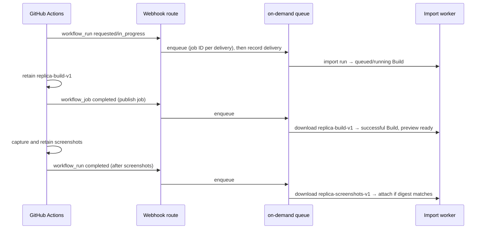

# GitHub Actions Builds

Hub imports Builds from selected GitHub Actions workflows in connected prototype repositories. The default is `.github/workflows/replica.yml`. The workflow uploads static output with the [publish action](../../actions/build/publish/action.yml) and captures screenshots in a dependent job with the [screenshots action](../../actions/build/screenshots/action.yml). Hub pulls each package through the GitHub API. It imports the dist when the publish job finishes, without waiting for screenshots. A failed or missing screenshot job does not fail an already imported Build.

## Requirements

The Hub that imports a repository's Builds is the Hub whose GitHub App is installed on that repository. The App needs **Actions: read** and **Contents: read** and must subscribe to the **Workflow runs**, **Workflow jobs**, **Push**, and **Branch or tag deletion** webhook events. Hub imports only `push` runs of selected workflows in connected repositories, not pull request, `workflow_dispatch`, or `workflow_run` triggered runs. To exclude tag runs, each selected workflow must restrict its trigger to branches. The installer branch is excluded. Imports never create repositories.

Create the App manually and connect it with the `setup:post` wizard. If the App was created before these settings were required, open its **Permissions & events** settings, confirm **Actions: read** and **Contents: read**, select these four events under **Subscribe to events**, and save. If either permission was added, each installation must accept the updated permissions.

Webhooks give the fastest import. Without webhook reachability, [recovery](#recovery) still imports retained artifacts by polling, typically within about five minutes after Hub is available. Workflows do not contact Hub directly or need publishing credentials.

## Select build workflows

Set `builds.workflows` in `.github/replica.json` on the connected repository's actual default branch. For example, Mini-Foundry can select its existing top-level caller:

```json
{
  "version": 1,
  "builds": {
    "workflows": [".github/workflows/publish-proto.yml"]
  }
}
```

Before adding `builds`, upgrade every selected workflow's Replica publish, screenshots, and optional build actions to the same reviewed revision that supports the field. Earlier revisions, including `5ec2d4ad6d5343b61684ba2c7a1c8c82e2914565`, reject it during packaging. The example below pins `9b030400819cecb3ea513df206bce6b5f5a741ff`, which includes this support. Keep existing `hub` and `templates` fields alongside `builds`; supported actions validate the new field but exclude it, like `hub`, from packaged template metadata.

Hub reads the default branch from GitHub, resolves its commit, and checks its Git tree before reading configuration at that exact revision. Neither `.github` nor `replica.json` may be a symbolic link. Incomplete directory listings stop selection rather than count as missing configuration. Hub never uses the prototype branch's configuration, so existing prototype branches need no configuration update. Webhooks only queue run IDs; import workers and recovery enforce the same validated selection. Each import job or repository poll reads a fresh selection; changing the file affects subsequent work without replacing or deleting successful Builds.

Removing a workflow stops artifact imports from it. Its next import pass marks any queued or running Build still owned by that run as failed with a configuration explanation, so it leaves the awaiting-import sweep. For a completed run, it records only the attempt's completion on an owned successful or failed Build, which ends automatic author and screenshot recovery for that attempt. It does not create Builds, transfer ownership, change artifacts or owners, or rewrite failure details. To retry a stopped Build, select the workflow again and rerun it as a new run or attempt; use the [author repair command](#commit-authors) for missing authors.

An omitted file, `builds`, or `builds.workflows` keeps the legacy default. An explicit list replaces that default; include `.github/workflows/replica.yml` explicitly to select it too. Use one to ten unique paths directly under `.github/workflows/`, ending in `.yml` or `.yaml`. Filenames must start with an ASCII letter or digit and contain only letters, digits, dots, underscores, or hyphens; each complete path is limited to 255 characters. Configuration must be a regular JSON file of at most 16 KiB. Invalid configuration stops imports and discovery with an error naming the configuration file; provider failures do not select a fallback workflow.

GitHub identifies reusable workflow runs by the top-level caller, not the called workflow. Select `publish-proto.yml`, not Mini-Foundry's reusable `publish-proto-core.yml`. Selection alone does not add publishing jobs or make Azure output suitable for Hub: the selected caller must produce the existing Replica artifacts with a Hub-compatible root base path (`VITE_BASE=/`). This configuration does not modify downstream workflows or Azure publishing.

When several selected workflows publish the same branch and commit, they share one Build. Existing run and attempt ordering still governs unfinished Builds. The first successful dist import remains immutable, and later screenshots attach only when their digest matches that dist. Select workflows that intentionally produce the same Hub output rather than competing variants.

## Configure the prototype workflow

Save this as `.github/workflows/replica.yml` in a connected prototype repository. Replace the build steps with the repository's own build; they must write static output, with an `index.html`, to `dist` or to the directory set in `output-directory`.

The example runs on every pushed branch, including nested `proto/` branches, and not on tag pushes. Use a branch filter in existing workflows too: GitHub's workflow run data does not reliably distinguish a tag from a same-named branch. If you restrict workflow branches, include `branches: ['proto/**']` to cover names such as `proto/settings/mobile`. Add patterns for any other branches users track manually; a branch without a workflow run cannot produce an imported Build.

The example pins both Replica actions to the same implementation revision. That revision must be available on GitHub before enabling the workflow in another repository. When upgrading, replace both references with the same reviewed commit.

```yaml
name: Replica

on:
  push:
    branches: ["**"]

permissions:
  contents: read

jobs:
  publish:
    runs-on: ubuntu-latest
    steps:
      - uses: actions/checkout@3d3c42e5aac5ba805825da76410c181273ba90b1 # v7.0.1
        with:
          persist-credentials: false
      - uses: actions/setup-node@949feb2413d6458794dcd2491c4babbbce0c15c1 # v7.1.0
        with:
          node-version: 24
      - run: npm ci
      - run: npm run build
      - uses: github/replica/actions/build/publish@9b030400819cecb3ea513df206bce6b5f5a741ff

  screenshots:
    needs: publish
    runs-on: ubuntu-latest
    steps:
      - uses: actions/checkout@3d3c42e5aac5ba805825da76410c181273ba90b1 # v7.0.1
        with:
          persist-credentials: false
      - uses: github/replica/actions/build/screenshots@9b030400819cecb3ea513df206bce6b5f5a741ff
```

The publish action validates and packages the output and uploads `replica-build-v1`. It installs no npm packages and no browser. Its completed-job event queues the Hub import while the dependent screenshot job downloads that exact artifact and uploads `replica-screenshots-v1`. The preview becomes available after webhook delivery, queue processing, and artifact import, not immediately on upload. If the build or artifact upload fails, GitHub skips screenshots and Hub records the failed Build.

Keep publish last in its job: later steps delay the completed-job event used for import. Putting screenshots in that same job delays import until they finish. Keep checkout credentials disabled and pin actions to reviewed commits.

The optional [build action](../../actions/build/action.yml) is still available. It runs `npm ci` and `npm run build` as a non-root user in a Node container. With `screenshots: separate`, it uploads the same dist package as the publish action and can replace the build steps and publish action above. Existing single-job workflows remain compatible: `screenshots` defaults to `inline`, which uploads one package containing the dist and screenshots, so Hub imports it only after screenshots finish.

To use the build and publish actions as separate steps, set `build-only: 'true'` on the build action, then call the publish action. Build-only mode leaves the static output in the workspace without packaging, uploads, browser installation, or screenshot capture. Without this option, both actions upload `replica-build-v1`, and GitHub rejects the duplicate artifact name.

For [standalone private previews](build-previews.md#standalone-private-previews), compile the site for `/previews/github/<githubRepositoryId>/<owningWorkflowRunId>/` and pass that path as `base-path` to the action that packages the output. Pass the same path to the standalone screenshot action, if used. Leave the input unset for existing root-based workflows. Setting the input records the mount in the package and changes the capture server's mount; it does not change compiled URLs.

If Hub is offline during an update, the workflow can still upload both artifacts to GitHub. GitHub does not automatically retry failed webhook deliveries. Once Hub returns, polling or requested redelivery can import the retained packages. Hub still needs GitHub API and artifact-download access. Recovery is bounded by the three-day artifact retention and polling window; expired packages cannot be recovered automatically. Re-running the workflow is safe because successful Builds and artifacts are never replaced.

### Screenshot dimensions

The [shared viewport settings](../client/utils/screenshot-viewports/viewports.json) define the capture width and minimum height for desktop and narrow screenshots. The build action uses these settings for both capture and package validation. Hub uses the same desktop ratio for prototype cards, template cards, and template-picker thumbnails, so a viewport-height image fills its frame without changing shape. Taller pages retain their full height; prototype and template cards reveal the remaining content on hover, keyboard focus, or manual scrolling.

Change these settings rather than adding independent sizes to workflow YAML or card styles. Capture at least the configured height, not a fixed full-page height. The widths remain part of the versioned artifact contract; changing them also requires updating Hub's import and decision-model consumers. Existing Build images are immutable. To use revised capture settings, pin the prototype workflow's Replica actions to the new implementation commit and push a new Build. Deploy the matching Hub change to update displayed frame ratios.

## Flow



For connected repositories, the webhook queues `workflow_run` (`requested`, `in_progress`, `completed`) and every completed `workflow_job`, because job events are the earliest signal that the dist artifact exists. Intake makes no GitHub provider requests before acknowledging delivery. The import worker reads GitHub's run record, rejects ineligible events and branches before loading configuration, then checks the selected caller path. `workflow_run.completed` arrives only after every job, including screenshots, so it cannot provide early preview availability.

The route enqueues before recording the delivery receipt. A queue failure therefore leaves the delivery unrecorded, so [recovery](#recovery) can redeliver it. Each delivery gets its own job ID, so an event that arrives while an earlier import of the same run is active still triggers another pass.

## Import worker

`import-github-workflow-run` runs on the on-demand queue with five attempts and exponential backoff from 15 seconds. It reads the run through the GitHub API rather than trusting the webhook payload, and ignores runs outside the selected workflows, non-`push` runs, the installer branch, and unconnected repositories.

One Build exists per prototype identity and commit. Each pass is idempotent:

- Without a dist artifact, an in-progress run marks the Build `running`; a completed run fails it with the run conclusion.
- With the newest unexpired `replica-build-v1` artifact, Hub downloads at most 160 MiB, validates and extracts up to 150 MiB of package files, writes files to [artifact storage](artifact-storage.md), and commits the successful Build with its `distDigest` and artifact records in one transaction.
- Invalid, expired, or oversized packages fail the Build with a summary. Network, storage, and database errors throw so the job retries.
- A successful Build is never re-imported, replaced, or deleted.

GitHub lists named artifacts across rerun attempts. Hub prefers packages created at or after the current attempt's `run_started_at`. If that attempt has no dist package, Hub reuses an unexpired dist from an earlier attempt of the same run only when the Build already has that digest or the current attempt's screenshots name it. This supports **Re-run failed jobs** when only screenshots failed and GitHub keeps the successful publish job's artifact. During a full rerun, the current attempt has no screenshots yet, so Hub waits for that attempt's own dist instead of fixing the Build to the earlier one. If the run completes without a matching dist, the Build fails without storing the earlier package. The first successful dist import fixes the Build's digest; subsequent attempts never replace it, and screenshots attach only when their digest matches that Build.

Hub records each contributing run's completed attempt only after author resolution, registration, and screenshot processing finish. A provider, transport, or storage error leaves that run pending for recovery even if the dist preview is already available. The awaiting-import retry and workflow discovery both retry failed Builds without an author or completed watermark, without reopening the Build or replacing its failure details. A deselected completed run settles that attempt, so it leaves both scans; reselection needs a new run or attempt, or the repair command. The existing deselected-workflow failure summary distinguishes a stopped unfinished Build, so keep its stored text stable. A newer attempt still needs its own pass; delayed completion from an older attempt cannot undo a newer receipt. Owning-run completion and immutable dist ownership remain unchanged.

The optional [private preview writer](artifact-storage.md#private-preview-output) runs after ordinary import work. Its failure uses the import job's retries without undoing the ordinary Build or its completion record. Scheduled import recovery does not revisit completed imports solely for preview publication. After the retries stop, an operator can [replay one pending preview](artifact-storage.md#replay-a-pending-private-preview) without changing the import record.

Storage keys derive from the Build, file path, and content. Retries reuse identical objects, a key with different bytes stops the import, and keys are never deleted. Unreferenced keys left by an interrupted import are harmless.

### Commit authors

Hub resolves the linked GitHub account from the imported commit SHA, not the workflow actor or free-text commit name/email. Builds retain that provider identity and login. Imports and repairs do not create Hub users or assign or replace Prototype owners: commit attribution is not authenticated ownership. Without an owner, the index and detail header use the current Build's GitHub author snapshot (or the latest Build when none is current), and index search uses that same visible author. Bots remain bot accounts, and a commit response without a linked account remains unknown with a warning. Failed commit lookups, including HTTP 404 or 422, are reported and retried instead of being treated as an unlinked author. Available artifacts still import; recovery can requeue eligible Builds while their completed import pass remains unrecorded. Later passes reuse an existing GitHub identity without another commit lookup.

Builds whose completed import pass was already recorded are not automatically revisited solely for missing author metadata. From `hub/`, use the existing configured App and database connection to inspect one retained Build:

```sh
npm run github:repair-author -- --repository-id GITHUB_NUMERIC_REPOSITORY_ID --build-id BUILD_UUID
```

The default only resolves the saved commit. An `available` result shows the proposed author, whether the Build metadata would update, remain unchanged, or be preserved, and that the Prototype owner stays unchanged. It does not write. After approving the target, add `--apply` to fill missing Build identity metadata. Repeated application returns `unchanged`; an existing different or incomplete author snapshot returns `preserved`. The write rechecks the connected repository, Build, commit, and run after the provider lookup, so concurrent changes may alter the result. No Prototype owner, artifacts, Build state, workflow ownership, or current selection are replaced. This command can repair older retained Builds outside the polling window. Applying it to production requires separate approval; do not paste credentials into arguments.

For a built image with runtime secrets already supplied, use `npm run start:github:repair-author --` with the same arguments. For an Azure installation that loads Key Vault secrets at startup, use:

```sh
node dist/server/scripts/azure-entrypoint/index.js repair-github-build-author --repository-id GITHUB_NUMERIC_REPOSITORY_ID --build-id BUILD_UUID
```

The Azure command loads the existing runtime secret references in the maintenance process before running the repair. It does not change the running Hub process or its configuration.

## Automatic prototype registration

A successful imported Build on a branch starting with `proto/` automatically registers that branch's Prototype. The rule is case-sensitive and includes nested names such as `proto/settings/mobile`. Both webhook imports and recovery use the same registration path. Queued or failed Builds do not register a new Prototype.

Registration sets the existing `Prototype.registeredAt` timestamp and uses the branch name only when no name has been saved. Repeated imports preserve that timestamp and never replace a saved name, description, or other prototype metadata. Repository and prototype locks serialize registration with metadata edits.

Other branches still import Builds but remain unregistered until a user tracks them manually in Hub. The default branch, reserved `replica/install-workflow` branch, internal replica owners, and deleted branches never auto-register. Stale imports cannot recreate a retired branch's Prototype. Existing registrations are not removed or reclassified.

Branch `delete` events and `push` events with `deleted: true` retire the branch without deleting its metadata, Builds, or artifacts. Hub keeps a retirement record even if deletion arrives before the first workflow import. Branch polling never infers deletion from a missing branch; the App's deletion-event subscription and webhook recovery provide that evidence.

A returning branch resumes its latest retired Prototype only when its saved head is unchanged or GitHub confirms that head is an ancestor of the returning head. A shared ancestor is not enough. Hub saves the deleted head only from GitHub's evidence: the `before` SHA of a branch-deleting push, accepted only when it is that Prototype's last observed head or the commit of one of its Builds. A `delete` event carries no SHA, so it never sets the saved head; a later push can fill a missing head but never replace one. An unrelated history, or a retirement with no proven head, gets a separate, initially unregistered Prototype. The retired Prototype keeps its name, description, reviews, share links, and Builds. None of those relationships transfers to the replacement.

Hub captures the owning Prototype and a revision before listing branches or comparing commits. It applies the result only while both still match, under the same repository lock used by deletion and workflow preparation. A newer observation, retirement, or replacement invalidates an older result even when the head SHA repeats. GitHub failures and invalid or contradictory ancestry responses leave the retired identity untouched and are logged for the next recovery pass. The migration does not backfill saved heads, because a selected Build does not prove which head GitHub deleted. Branches retired before it get a separate identity when they return.

Replacement histories reject workflow runs created at or before the recorded deletion, except for the exact head confirmed by the new listing. This lets a retained workflow for the replacement's current head import without admitting an old history's delayed workflow. Retired Builds cannot suppress recovery for the replacement.

Deletion events are still recorded when received, rather than confirmed synchronously against GitHub. A delayed delete can temporarily retire a live branch; the next poll checks continuity before resuming the latest identity. A delete received after restoration causes another such check. When only a SHA-less `delete` event arrives, continuity is lost, but every retained relationship stays on the retired identity. Deletion events missed beyond the recovery window cannot establish a lifecycle boundary. A replacement's intermediate workflow runs that predate a delayed deletion receipt are conservatively skipped unless their commit is its confirmed current head; re-running the full workflow on the current head remains safe.

`registeredAt !== null` remains the registration contract, alongside existing repository, branch, and visibility checks. Gallery search also includes the displayed Build author when the Prototype has no owner.

## Artifact contracts

`replica-build-v1` contains `dist/**` and an optional `templates.json` (version 1, at most 12 entries, at most 16 KiB). Hub extracts and validates templates with the dist; the templates API is separate.

`replica-screenshots-v1` contains `screenshots/**` and `screenshots.json`, `{ "version": 1, "distDigest": "sha256:…" }`. `distDigest` is the SHA-256 of the sorted `path\0sha256\n` lines for every dist file and `templates.json`.

Both packages use the same path, size, and entry-count limits as local Builds:

| Content                        | Limit                       |
| ------------------------------ | --------------------------- |
| Each static file               | 100 MiB (104,857,600 bytes) |
| All uncompressed `dist/` files | 100 MiB                     |
| Each screenshot                | 25 MiB                      |
| All extracted package files    | 150 MiB                     |
| Downloaded ZIP                 | 160 MiB                     |

A separate data asset must leave room for `index.html` and the rest of the app within the total `dist/` budget. Package validation also enforces path, entry-count, and archive protections.

Hub buffers the downloaded ZIP and extracted files in memory; storage writes also copy the current file to preserve its bytes during the write. Keep the default on-demand worker concurrency of one for the 1 GiB Azure runtime. Additional concurrent imports need memory headroom. The [preview layer](build-previews.md#file-behavior) bounds buffered responses across concurrent HTTP requests independently of worker concurrency.

To publish larger files, run Hub with this limit and update every selected workflow's Replica publish, screenshots, and optional build actions to the same reviewed revision containing it. Older action pins retain their earlier limits. Updating Replica alone neither deploys Hub nor changes downstream workflow references.

## Screenshots

Each pass after the dist import also looks for screenshots. Hub attaches them only when their `distDigest` matches the successful Build. Repeated passes add no duplicates and never replace existing artifact records. Invalid packages are logged and ignored; a digest mismatch leaves screenshots unattached. A Build whose screenshots never arrive stays successful and previewable without them.

The capture job takes the prototype screenshot at `/` and captures declared template routes separately. The Prototypes gallery shows the newest successful Build with a saved desktop screenshot, even if a newer Build is pending, failed, or has not yet imported its screenshot. The current Build status does not change. If a thumbnail is missing, check the `replica-screenshots-v1` upload and Hub import before changing the workflow.

## Recovery

GitHub does not retry failed webhook deliveries, so scheduled jobs recover missed events and stalled imports. Each job is idempotent, and none deletes Builds or artifacts.

| Schedule         | Job                                   | Purpose                                                                                                                                                           |
| ---------------- | ------------------------------------- | ----------------------------------------------------------------------------------------------------------------------------------------------------------------- |
| Every minute     | `recover-github-webhook-deliveries`   | Scans the App's recent webhook deliveries from a saved checkpoint and asks GitHub to redeliver workflow, installation, and access events that Hub never recorded. |
| Every 5 minutes  | `discover-github-workflow-runs`       | Polls branch heads and recent Replica workflow runs for connected repositories and enqueues unsettled runs, so Builds arrive even without webhooks.               |
| Every 5 minutes  | `retry-github-builds-awaiting-import` | Re-enqueues queued or running Builds, successful Builds whose final author or screenshot pass is still owed, and failed Builds whose author lookup is still owed. |
| Every 15 minutes | `reconcile-github-installation`       | Refreshes the installation's repository list.                                                                                                                     |

Webhook redelivery covers deliveries from the past three days, the limit of GitHub's delivery history. It retries unrecorded deliveries with status 0, 401, 403, 404, 429, or 5xx, including access-removal events rejected during an authentication or routing outage. A lease lets one worker run at a time. Each missed delivery is retried at most 12 times, with backoff from one minute to one hour, and settled records are removed after 30 days. Redelivery cannot help while Hub is unreachable; discovery and retry then import the Build once Hub is back, as long as its artifact has not expired.

Discovery and retry look back three days, matching the artifacts' retention. Runs older than that, or whose artifacts expired, are not imported.

Branch polling selects a matching existing Build when a branch returns to an earlier commit; it does not invent a Build without a workflow package or delete branches. Poll observations do not replace workflow creation times or rewrite an unchanged prototype selection. Reselection retains the latest workflow timestamp and run ID so a known run's redelivery cannot undo it, while a new run can still become current. When an older installation has a selection timestamp but no saved run ID, runs with the same timestamp do not replace the selection because their order is unknown; a later timestamp can still select a Build.

Each poll bounds branch listing to ten pages of 100. Workflow discovery queries each selected workflow and removes duplicate run IDs. It pages through recent runs within the recovery window, up to GitHub's 1,000-result filtered-search limit per workflow; reaching that limit reports an error instead of silently accepting a truncated list. A provider failure for any selected workflow rejects that repository's discovery pass rather than returning a partial list. Saved queued, running, incomplete successful, and author-pending failed Builds are retried separately, so they do not depend on discovery's limits. A very busy repository can therefore outrun discovery of previously unseen runs; recovery is a safety net, not an unlimited delivery guarantee. Runs that reuse an immutable Build or have lost ownership to a newer run do not keep queuing redundant imports. Webhook imports and polling share immutable Build ownership, so whichever valid dist import commits first wins.

### Verify webhook communication

From `hub/`, using an existing authorized runtime environment:

```sh
npm run github:check-webhooks -- --repository-id GITHUB_NUMERIC_REPOSITORY_ID --run-id WORKFLOW_RUN_ID
```

For a built image with runtime secrets already supplied, use `npm run start:github:check-webhooks --` with the same arguments. For an Azure installation using runtime Key Vault references, use:

```sh
node dist/server/scripts/azure-entrypoint/index.js check-github-webhooks --repository-id GITHUB_NUMERIC_REPOSITORY_ID --run-id WORKFLOW_RUN_ID
```

This command checks App JWT signing/identity, installation access, repository-scoped Actions/Contents token access, the exact webhook URL (`HUB_APPLICATION_ORIGIN/api/github/webhooks`), JSON/TLS settings, required event subscriptions, and App delivery-history reads. It issues a short-lived installation token but does not send an event, request redelivery, change settings, or write database records. It never outputs tokens, the webhook secret, response payloads, or configured URLs.

App delivery-history endpoints use an **App JWT**, not an installation token. A successful artifact download therefore does not prove delivery-recovery access. Recovery errors distinguish HTTP rejection (including the status), transport failure, and an invalid successful response; none is silently treated as success. HTTP 401 requires checking App ID/key validity and clock, while 403 requires checking App authority and provider policy. Those statuses are evidence to investigate, not proof of one particular configuration fault.

Delivery IDs are positive int64 values and can exceed JavaScript's safe integer range. Hub preserves those JSON integer tokens as decimal strings through database storage and redelivery URLs, rather than rounding them. A schema rejection on a successful delivery-history response is not an authentication failure.

To inspect a real delivery, obtain its GUID from this repository's GitHub App delivery history and add `--delivery-guid DELIVERY_UUID`. The command only reads receipts after finding that GUID for the selected installation and repository in the latest 100 App deliveries. It uses a read-only database transaction with a five-second statement timeout. Missing or older provider history is `unknown`, not a pass. A receipt proves Hub accepted the signature and handled/enqueued the event, not that import finished. The separate repository/run Build check requires completion evidence for the attempt currently reported by GitHub, including runs that contributed to another run's Build; polling can also have processed that run. Neither check associates the delivery with the supplied run. A `succeeded` recovery record may be settled from an existing receipt or provider delivery, so it does not prove a redelivery occurred.

For end-to-end testing, use a dedicated test installation/repository and a normal signed `workflow_run` or `workflow_job` event from its prototype workflow. Verify the GUID receipt, Build commit/run/artifact linkage, and any recovery state. GitHub's **Redeliver** action sends a real event and can enqueue imports; it needs separate production approval. A webhook ping alone does not establish workflow import or recovery. Local route and recovery tests cover signature rejection, queue failure, receipts, and redelivery without production traffic.

## Not yet implemented

Workflow-installation UI, Build start pages, and the templates API are later increments.
