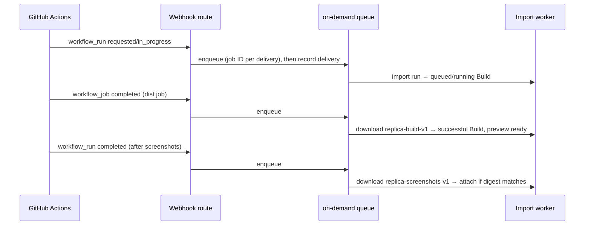

# GitHub Actions Builds

Hub imports Builds that prototype repositories produce with the shared [build action](../../actions/build/action.yml) in `.github/workflows/replica.yml`. With separate jobs, Hub can import the dist when the build job finishes, without waiting for screenshots. Screenshots attach to that same Build later; a failed or missing screenshot job does not fail an already imported Build.

## Requirements

The GitHub App needs **Actions: read** and must subscribe to the **Workflow runs** and **Workflow jobs** webhook events. Hub imports only repositories that installation reconciliation has already connected; imports never create repositories.

## Configure the prototype workflow

Save this as `.github/workflows/replica.yml` in a connected prototype repository. It requires a Linux runner with Docker, a committed `package-lock.json`, and an npm `build` script that writes `dist/index.html`.

The example pins both actions to the same implementation revision. That revision must be available on GitHub before enabling the workflow in another repository. When upgrading, replace both action references with the same reviewed commit containing the dist and screenshot actions.

```yaml
name: Replica

on:
  push:

permissions:
  contents: read

jobs:
  build:
    runs-on: ubuntu-latest
    steps:
      - uses: actions/checkout@3d3c42e5aac5ba805825da76410c181273ba90b1 # v7.0.1
        with:
          persist-credentials: false
      - uses: github/replica/actions/build@b7e5d6b057aa5993543f401ebd74b98597ce1c5b
        with:
          screenshots: separate

  screenshots:
    needs: build
    runs-on: ubuntu-latest
    steps:
      - uses: actions/checkout@3d3c42e5aac5ba805825da76410c181273ba90b1 # v7.0.1
        with:
          persist-credentials: false
      - uses: github/replica/actions/build/screenshots@b7e5d6b057aa5993543f401ebd74b98597ce1c5b
```

The build job uploads `replica-build-v1` and finishes without installing Chromium or taking screenshots. Its completed-job event queues the Hub import while the dependent screenshot job downloads that exact artifact and captures images. The preview becomes available after webhook delivery, queue processing, and artifact import, not immediately on upload. Screenshot completion queues another import to attach the images.

Keep the action last in the build job: later steps delay the completed-job signal. Putting both actions in one job also delays import until screenshots finish, even with `screenshots: separate`.

Existing single-job workflows remain compatible: `screenshots` defaults to `inline`, which uploads the dist before capturing screenshots but normally signals Hub only after all steps finish. Moving to the two-job layout is required for early import through completed-job events.

For an existing build command or npm proxy configuration, run that build in earlier steps of the build job and set `skip-build: "true"` on the build action. Set `output-directory` if the command writes somewhere other than `dist`. Keep `screenshots: separate`; the screenshot job consumes the normalized package regardless of the original output directory. Ensure action dependency installation can also reach the approved npm registry.

## Flow



The webhook accepts `workflow_run` (`requested`, `in_progress`, `completed`) for the Replica workflow path, and every completed `workflow_job`, because job events are the earliest signal that the dist artifact exists. `workflow_run.completed` arrives only after every job, including screenshots, so it cannot provide early preview availability.

The route enqueues before recording the delivery receipt. A queue failure therefore leaves the delivery available for manual redelivery; GitHub does not automatically retry failed webhook deliveries. Each delivery gets its own job ID, so an event that arrives while an earlier import of the same run is active still triggers another pass.

## Import worker

`import-github-workflow-run` runs on the on-demand queue with five attempts and exponential backoff from 15 seconds. It reads the run through the GitHub API rather than trusting the webhook payload, and ignores runs that are not `push` runs of the Replica workflow, the installer branch, or unconnected repositories.

One Build exists per repository, branch, and commit. Each pass is idempotent:

- Without a dist artifact, an in-progress run marks the Build `running`; a completed run fails it with the run conclusion.
- With the newest unexpired `replica-build-v1` artifact, Hub downloads at most 150 MiB, validates and extracts it, writes files to [artifact storage](artifact-storage.md), and commits the successful Build with its `distDigest` and artifact records in one transaction.
- Invalid, expired, or oversized packages fail the Build with a summary. Network, storage, and database errors throw so the job retries.
- A successful Build is never re-imported, replaced, or deleted.

Storage keys derive from the Build, file path, and content. Retries reuse identical objects, a key with different bytes stops the import, and keys are never deleted. Unreferenced keys left by an interrupted import are harmless.

## Artifact contracts

`replica-build-v1` contains `dist/**` and an optional `templates.json` (version 1, at most 12 entries, at most 16 KiB). Hub extracts and validates templates with the dist; the templates API is separate.

`replica-screenshots-v1` contains `screenshots/**` and `screenshots.json`, `{ "version": 1, "distDigest": "sha256:…" }`. `distDigest` is the SHA-256 of the sorted `path\0sha256\n` lines for every dist file and `templates.json`.

Both packages use the same path, size, and entry-count limits as local Builds.

## Screenshots

Each pass after the dist import also looks for screenshots. Hub attaches them only when their `distDigest` matches the successful Build. Repeated passes add no duplicates and never replace existing artifact records. Invalid packages are logged and ignored; a digest mismatch leaves screenshots unattached. A Build whose screenshots never arrive stays successful and previewable without them.

## Not yet implemented

Workflow-installation UI, discovery and recovery of missed deliveries, Build start pages and authorship display, and the templates API are later increments. Until recovery exists, a missed delivery can leave its run unimported; operators must monitor and manually redeliver failed webhooks.
