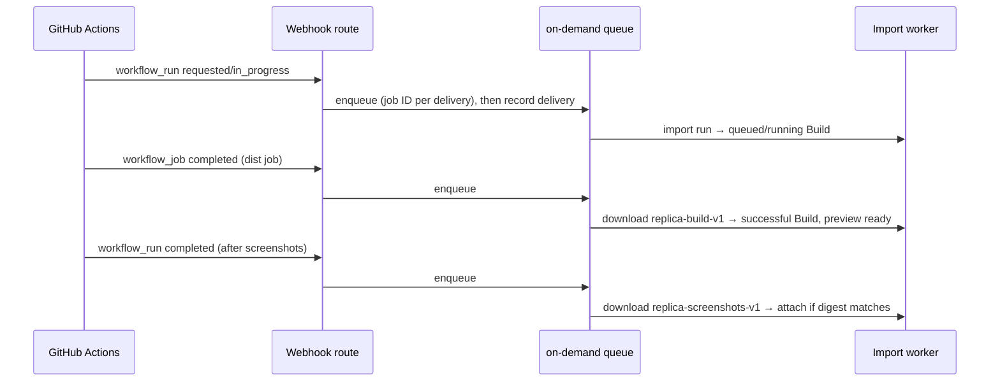

# GitHub Actions Builds

Hub imports Builds that prototype repositories produce with the shared [build action](../../actions/build/action.yml) in `.github/workflows/replica.yml`. The preview becomes usable as soon as the dist job uploads its package. Screenshots arrive later and attach to that same Build; a slow, failed, or missing screenshot job never delays, fails, or changes a Build.

## Requirements

The GitHub App needs **Actions: read** and must subscribe to the **Workflow runs** and **Workflow jobs** webhook events. Hub imports only repositories that installation reconciliation has already connected; imports never create repositories.

## Flow

The webhook accepts `workflow_run` (`requested`, `in_progress`, `completed`) for the Replica workflow path, and every completed `workflow_job`, because job events are the earliest signal that the dist artifact exists. `workflow_run.completed` arrives only after every job, including screenshots, so it cannot provide early preview availability.

The route enqueues before recording the delivery receipt. A queue failure therefore returns an error and GitHub can redeliver. Each delivery gets its own job ID, so an event that arrives while an earlier import of the same run is active still triggers another pass.

## Import worker

`import-github-workflow-run` runs on the on-demand queue with five attempts and exponential backoff from 15 seconds. It reads the run through the GitHub API rather than trusting the webhook payload, and ignores runs that are not `push` runs of the Replica workflow, the installer branch, or unconnected repositories.

One Build exists per repository, branch, and commit. Each pass is idempotent:

- Without a dist artifact, an in-progress run marks the Build `running`; a completed run fails it with the run conclusion.
- With the newest unexpired `replica-build-v1` artifact, Hub downloads at most 150 MiB, validates and extracts it, writes files to [artifact storage](artifact-storage.md), and commits the successful Build with its `distDigest` and artifact records in one transaction.
- Invalid, expired, or oversized packages fail the Build with a summary. Network, storage, and database errors throw so the job retries.
- A successful Build is never re-imported, replaced, or deleted.

Storage keys derive from the Build, file path, and content. Retries reuse identical objects, a key with different bytes stops the import, and keys are never deleted. Unreferenced keys left by an interrupted import are harmless.

## Artifact contracts

`replica-build-v1` contains `dist/**` and an optional `templates.json` (version 1, at most 12 entries, at most 16 KiB). Hub extracts and validates templates with the dist; the templates API is separate.

`replica-screenshots-v1` contains `screenshots/**` and `screenshots.json`, `{ "version": 1, "distDigest": "sha256:…" }`. `distDigest` is the SHA-256 of the sorted `path\0sha256\n` lines for every dist file and `templates.json`.

Both packages use the same path, size, and entry-count limits as local Builds.

## Screenshots

Each pass after the dist import also looks for screenshots. Hub attaches them only when their `distDigest` matches the successful Build. Repeated passes add no duplicates and never replace existing artifact records. A digest mismatch or invalid package is logged and ignored. A Build whose screenshots never arrive stays successful and previewable without them.

## Not yet implemented

Discovery and recovery of missed deliveries, Build start pages and authorship display, and the templates API are later increments. Until recovery exists, a delivery GitHub never retried leaves its run unimported.
