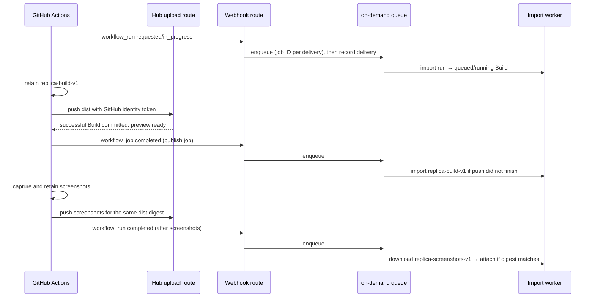

# GitHub Actions Builds

Hub imports Builds that prototype repositories produce in `.github/workflows/replica.yml`. The [publish action](../../actions/build/publish/action.yml) retains the built static output in GitHub and pushes it to the configured Hub. The [screenshots action](../../actions/build/screenshots/action.yml) captures and publishes screenshots in a dependent job. The preview can become available before screenshot capture starts. A failed or missing screenshot job does not fail an already imported Build.

## Requirements

Set `hub-url` to the Hub's public origin, matching `HUB_APPLICATION_ORIGIN`, and grant `id-token: write` to the publishing jobs. Hub verifies a short-lived GitHub Actions identity token for its own origin; no shared publishing secret is needed. Pushes must come from branch `push` runs of `.github/workflows/replica.yml` in a connected repository. The installer branch cannot publish.

The Hub's GitHub App must be installed on that repository. The App needs **Actions: read** and **Contents: read** and must subscribe to the **Workflow runs** and **Workflow jobs** webhook events. Hub checks run identity through GitHub even for pushes. Imports never create repositories.

Create the App manually and connect it with the `setup:post` wizard. If the App was created before these settings were required, open its **Permissions & events** settings, confirm **Actions: read** and **Contents: read**, select **Workflow run** and **Workflow job** under **Subscribe to events**, and save. If either permission was added, each installation must accept the updated permissions.

Keep webhooks enabled as a fallback behind push. Without webhook reachability, [recovery](#recovery) still imports retained artifacts by polling, typically within about five minutes after Hub is available. Omitting `hub-url` explicitly selects artifact-only publishing through that webhook and polling path.

## Configure the prototype workflow

Save this as `.github/workflows/replica.yml` in a connected prototype repository. Replace the build steps with the repository's own build; they must write static output, with an `index.html`, to `dist` or to the directory set in `output-directory`.

The example pins both Replica actions to the same implementation revision. That revision must be available on GitHub before enabling the workflow in another repository. When upgrading, replace both references with the same reviewed commit.

```yaml
name: Replica

on:
  push:

permissions:
  contents: read

jobs:
  publish:
    runs-on: ubuntu-latest
    permissions:
      contents: read
      id-token: write
    steps:
      - uses: actions/checkout@3d3c42e5aac5ba805825da76410c181273ba90b1 # v7.0.1
        with:
          persist-credentials: false
      - uses: actions/setup-node@949feb2413d6458794dcd2491c4babbbce0c15c1 # v7.1.0
        with:
          node-version: 24
      - run: npm ci
      - run: npm run build
      - uses: github/replica/actions/build/publish@d4d34c0810fe95177211269248c453fe019fb6aa
        with:
          hub-url: https://hub.example.com

  screenshots:
    needs: publish
    runs-on: ubuntu-latest
    permissions:
      contents: read
      id-token: write
    steps:
      - uses: actions/checkout@3d3c42e5aac5ba805825da76410c181273ba90b1 # v7.0.1
        with:
          persist-credentials: false
      - uses: github/replica/actions/build/screenshots@d4d34c0810fe95177211269248c453fe019fb6aa
        with:
          hub-url: https://hub.example.com
```

Replace `https://hub.example.com` with the Hub's public origin. The publish action validates and packages the output and uploads `replica-build-v1` before sending bytes to Hub. It installs no npm packages and no browser. A successful push means Hub has stored and committed the Build, not just queued it. The dependent screenshot job downloads that exact GitHub artifact, retains `replica-screenshots-v1`, then pushes it to Hub.

For artifact-only workflows, keep publish last in its job: later steps delay the completed-job event used for fallback import. Putting screenshots in that same job delays fallback until they finish. Push does not wait for the job-completion webhook.

Any code in a job with `id-token: write` can request its identity token. For stronger isolation, run repository build commands and npm dependencies in a separate job without that permission, then pass the output to a publish job. This limits access to the publishing identity, but does not make the built website trustworthy. Keep checkout credentials disabled and pin actions to reviewed commits.

The optional [build action](../../actions/build/action.yml) is still available. It runs `npm ci` and `npm run build` as a non-root user in a Node container. With `screenshots: separate`, it uploads the same dist package as the publish action and can replace the build steps and publish action above. Existing single-job workflows remain compatible: `screenshots` defaults to `inline`, which uploads one package containing the dist and screenshots, so Hub imports it only after screenshots finish.

The legacy build action does not push to Hub. Use the separate publish action for direct push; existing pinned workflows continue to use webhook and polling imports.

## Upload errors and retries

Publish and screenshots retain their GitHub artifacts for three days **before** contacting Hub. Network failures, request timeouts, HTTP 429, and HTTP 5xx retry twice by default, waiting 15 then 30 seconds. Each attempt requests a fresh identity token. `Retry-After` seconds or dates replace the backoff. If Hub asks for more than 60 seconds, publishing fails rather than retrying too early or waiting indefinitely.

Both actions accept `hub-retries` (0–5, default 2), `hub-retry-delay` (0–60 seconds, default 15), and `hub-timeout` (1–300 seconds per request, default 180). The default backoff adds 45 seconds; upload time and token requests are additional. A 60-second `Retry-After` can increase each wait to a minute.

Exhausted retries fail the job with the Hub origin, an offline or unreachable explanation, confirmation that re-running is safe, and the retained artifact name. HTTP 4xx authentication, permission, repository-connection, digest, and package errors are not retried, except for 429; they explain the rejected request. A failed token request also fails explicitly. Do not ignore a publishing failure just because recovery may import the artifact later.

If Hub is offline during an update, the fallback artifact remains on GitHub. Webhooks cannot reach an offline Hub and GitHub does not automatically retry failed deliveries. Once Hub returns, polling or requested webhook redelivery can import the retained dist, even if the publish job failed. Its dependent screenshot job is skipped; re-run the workflow when Hub is available to capture screenshots too. Reruns and ambiguous transmission failures cannot replace an already successful Build.

Push requires runner-to-Hub HTTPS reachability, GitHub OIDC key access, and GitHub API availability. Packages are buffered and imported during the request, so large uploads consume API memory and can reach proxy timeouts. Configure ingress for ZIP requests up to 160 MiB and the chosen request timeout. Use the artifact-only mode when a runner cannot reach Hub. Recovery is bounded by the three-day artifact retention and polling window; expired packages cannot be recovered automatically.

## Flow



The webhook accepts `workflow_run` (`requested`, `in_progress`, `completed`) for the Replica workflow path, and every completed `workflow_job`, because job events are the earliest signal that the dist artifact exists. `workflow_run.completed` arrives only after every job, including screenshots, so it cannot provide early preview availability.

The route enqueues before recording the delivery receipt. A queue failure therefore leaves the delivery unrecorded, so [recovery](#recovery) can redeliver it. Each delivery gets its own job ID, so an event that arrives while an earlier import of the same run is active still triggers another pass.

## Import worker

`import-github-workflow-run` runs on the on-demand queue with five attempts and exponential backoff from 15 seconds. It reads the run through the GitHub API rather than trusting the webhook payload, and ignores runs that are not `push` runs of the Replica workflow, the installer branch, or unconnected repositories.

One Build exists per repository, branch, and commit. Each pass is idempotent:

- Without a dist artifact, an in-progress run marks the Build `running`; a completed run fails it with the run conclusion.
- With the newest unexpired `replica-build-v1` artifact, Hub downloads at most 160 MiB, validates and extracts up to 150 MiB of package files, writes files to [artifact storage](artifact-storage.md), and commits the successful Build with its `distDigest` and artifact records in one transaction. Push uses the same validation, storage, and commit path.
- Invalid, expired, or oversized packages fail the Build with a summary. Network, storage, and database errors throw so the job retries.
- A successful Build is never re-imported, replaced, or deleted.

GitHub lists named artifacts across rerun attempts. For a rerun, fallback import only accepts packages created at or after that attempt's `run_started_at`. Missing timing evidence does not authorize an older package: an ongoing run stays pending and a completed run fails without a usable dist. Push also checks the token's run attempt against GitHub's current run.

Storage keys derive from the Build, file path, and content. Retries reuse identical objects, a key with different bytes stops the import, and keys are never deleted. Unreferenced keys left by an interrupted import are harmless.

## Artifact contracts

`replica-build-v1` contains `dist/**` and an optional `templates.json` (version 1, at most 12 entries, at most 16 KiB). Hub extracts and validates templates with the dist; the templates API is separate.

`replica-screenshots-v1` contains `screenshots/**` and `screenshots.json`, `{ "version": 1, "distDigest": "sha256:…" }`. `distDigest` is the SHA-256 of the sorted `path\0sha256\n` lines for every dist file and `templates.json`.

Both packages use the same path, size, and entry-count limits as local Builds.

## Screenshots

Each pass after the dist import also looks for screenshots. Hub attaches them only when their `distDigest` matches the successful Build. Repeated passes add no duplicates and never replace existing artifact records. Invalid packages are logged and ignored; a digest mismatch leaves screenshots unattached. A Build whose screenshots never arrive stays successful and previewable without them.

## Recovery

GitHub does not retry failed webhook deliveries, so scheduled jobs recover missed events and stalled imports. Each job is idempotent, and none deletes Builds or artifacts.

| Schedule         | Job                                   | Purpose                                                                                                                                                           |
| ---------------- | ------------------------------------- | ----------------------------------------------------------------------------------------------------------------------------------------------------------------- |
| Every minute     | `recover-github-webhook-deliveries`   | Scans the App's recent webhook deliveries from a saved checkpoint and asks GitHub to redeliver workflow, installation, and access events that Hub never recorded. |
| Every 5 minutes  | `discover-github-workflow-runs`       | Polls branch heads and recent Replica workflow runs for connected repositories and enqueues unsettled runs, so Builds arrive even without push or webhooks.       |
| Every 5 minutes  | `retry-github-builds-awaiting-import` | Re-enqueues recent GitHub Builds whose dist import or final screenshot pass is still owed.                                                                        |
| Every 15 minutes | `reconcile-github-installation`       | Refreshes the installation's repository list.                                                                                                                     |

Webhook redelivery covers deliveries from the past three days, the limit of GitHub's delivery history. A lease lets one worker run at a time. Each missed delivery is retried at most 12 times, with backoff from one minute to one hour, and settled records are removed after 30 days. Redelivery cannot help while Hub is unreachable; discovery and retry then import the Build once Hub is back, as long as its artifact has not expired.

Discovery and retry look back three days, matching the artifacts' retention. Runs older than that, or whose artifacts expired, are not imported.

Branch polling selects a matching existing Build when a branch returns to an earlier commit; it does not invent a Build without a workflow package or delete branches. Each poll bounds branch listing to ten pages of 100 and workflow discovery to the newest 50 runs per repository. Saved unfinished Builds are retried separately. A very busy repository can therefore outrun discovery of previously unseen runs; recovery is a safety net, not an unlimited delivery guarantee. Push, webhook imports, and polling share immutable Build ownership, so whichever valid dist import commits first wins.

## Not yet implemented

Workflow-installation UI, Build start pages and authorship display, and the templates API are later increments.
