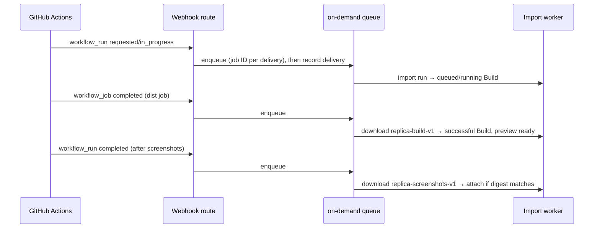

# GitHub Actions Builds

Hub imports Builds that prototype repositories produce in `.github/workflows/replica.yml`. The workflow builds the prototype, uploads its static output with the [publish action](../../actions/build/publish/action.yml), and captures screenshots in a dependent job with the [screenshots action](../../actions/build/screenshots/action.yml). Hub pulls each package through the GitHub API. It imports the dist when the publish job finishes, without waiting for screenshots. Screenshots attach to that same Build later; a failed or missing screenshot job does not fail an already imported Build.

## Requirements

The Hub that receives a repository's Builds is the Hub whose GitHub App is installed on that repository. The App needs **Actions: read** and must subscribe to the **Workflow runs** and **Workflow jobs** webhook events. Hub imports only repositories that installation reconciliation has already connected; imports never create repositories.

Create the App manually and connect it with the `setup:post` wizard. If the App was created before these settings were required, open its **Permissions & events** settings, confirm **Actions: read**, select **Workflow run** and **Workflow job** under **Subscribe to events**, and save. If the Actions permission was added too, each installation must accept the updated permissions.

Webhooks give the fastest import. Without them, for example when GitHub cannot reach Hub, [recovery](#recovery) still imports Builds by polling, typically within about five minutes.

## Configure the prototype workflow

Save this as `.github/workflows/replica.yml` in a connected prototype repository. Replace the build steps with the repository's own build; they must write static output, with an `index.html`, to `dist` or to the directory set in `output-directory`.

The example pins both Replica actions to the same implementation revision. That revision must be available on GitHub before enabling the workflow in another repository. When upgrading, replace both references with the same reviewed commit.

```yaml
name: Replica

on:
  push:

permissions:
  contents: read

jobs:
  publish:
    runs-on: ubuntu-latest
    steps:
      - uses: actions/checkout@3d3c42e5aac5ba805825da76410c181273ba90b1 # v7.0.1
        with:
          persist-credentials: false
      - uses: actions/setup-node@949feb2413d6458794dcd2491c4babbbce0c15c1 # v7.1.0
        with:
          node-version: 24
      - run: npm ci
      - run: npm run build
      - uses: github/replica/actions/build/publish@9af9a084bc776eb0104046e3f2d81cc1c874f214

  screenshots:
    needs: publish
    runs-on: ubuntu-latest
    steps:
      - uses: actions/checkout@3d3c42e5aac5ba805825da76410c181273ba90b1 # v7.0.1
        with:
          persist-credentials: false
      - uses: github/replica/actions/build/screenshots@9af9a084bc776eb0104046e3f2d81cc1c874f214
```

The publish action validates and packages the output and uploads `replica-build-v1`. It installs no npm packages and no browser. Its completed-job event queues the Hub import while the dependent screenshot job downloads that exact artifact and uploads `replica-screenshots-v1`. The preview becomes available after webhook delivery, queue processing, and artifact import, not immediately on upload. If the publish job fails, GitHub skips the screenshot job and Hub records the failed Build.

Keep the publish action last in its job: later steps delay the completed-job signal. Putting screenshots in the same job delays import until they finish.

The optional [build action](../../actions/build/action.yml) is still available. It runs `npm ci` and `npm run build` as a non-root user in a Node container. With `screenshots: separate`, it uploads the same dist package as the publish action and can replace the build steps and publish action above. Existing single-job workflows remain compatible: `screenshots` defaults to `inline`, which uploads one package containing the dist and screenshots, so Hub imports it only after screenshots finish.

## Flow



The webhook accepts `workflow_run` (`requested`, `in_progress`, `completed`) for the Replica workflow path, and every completed `workflow_job`, because job events are the earliest signal that the dist artifact exists. `workflow_run.completed` arrives only after every job, including screenshots, so it cannot provide early preview availability.

The route enqueues before recording the delivery receipt. A queue failure therefore leaves the delivery available for manual redelivery; GitHub does not automatically retry failed webhook deliveries. Each delivery gets its own job ID, so an event that arrives while an earlier import of the same run is active still triggers another pass.

## Import worker

`import-github-workflow-run` runs on the on-demand queue with five attempts and exponential backoff from 15 seconds. It reads the run through the GitHub API rather than trusting the webhook payload, and ignores runs that are not `push` runs of the Replica workflow, the installer branch, or unconnected repositories.

One Build exists per repository, branch, and commit. Each pass is idempotent:

- Without a dist artifact, an in-progress run marks the Build `running`; a completed run fails it with the run conclusion.
- With the newest unexpired `replica-build-v1` artifact, Hub downloads at most 150 MiB, validates and extracts it, writes files to [artifact storage](artifact-storage.md), and commits the successful Build with its `distDigest` and artifact records in one transaction.
- Invalid, expired, or oversized packages fail the Build with a summary. Network, storage, and database errors throw so the job retries.
- A successful Build is never re-imported, replaced, or deleted.

Storage keys derive from the Build, file path, and content. Retries reuse identical objects, a key with different bytes stops the import, and keys are never deleted. Unreferenced keys left by an interrupted import are harmless.

## Artifact contracts

`replica-build-v1` contains `dist/**` and an optional `templates.json` (version 1, at most 12 entries, at most 16 KiB). Hub extracts and validates templates with the dist; the templates API is separate.

`replica-screenshots-v1` contains `screenshots/**` and `screenshots.json`, `{ "version": 1, "distDigest": "sha256:…" }`. `distDigest` is the SHA-256 of the sorted `path\0sha256\n` lines for every dist file and `templates.json`.

Both packages use the same path, size, and entry-count limits as local Builds.

## Screenshots

Each pass after the dist import also looks for screenshots. Hub attaches them only when their `distDigest` matches the successful Build. Repeated passes add no duplicates and never replace existing artifact records. Invalid packages are logged and ignored; a digest mismatch leaves screenshots unattached. A Build whose screenshots never arrive stays successful and previewable without them.

## Not yet implemented

Workflow-installation UI, discovery and recovery of missed deliveries, Build start pages and authorship display, and the templates API are later increments. Until recovery exists, a missed delivery can leave its run unimported; operators must monitor and manually redeliver failed webhooks.
