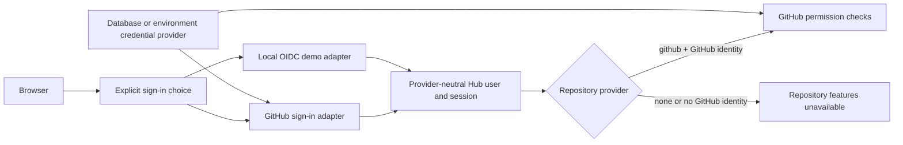

# Identity provider decoupling demo

This local branch demonstrates how Hub can identify a user independently from GitHub repository access. It is intended for team discussion and video recording, not deployment or merge.

## Architecture



The boundaries are:

- **Sign-in provider:** proves who the user is and returns a stable provider name, subject, login, name, and avatar.
- **Repository provider:** decides whether repository-dependent capabilities exist and performs current permission checks.
- **Credential provider:** reads or encrypts GitHub App and OAuth secrets. It is infrastructure configuration, not a user identity.
- **Hub session:** stores the provider-neutral user and session. Generic session and revocation routes do not depend on the selected sign-in adapter.

Provider-specific routes stay under `/api/auth/github` and `/api/auth/oidc-demo`. The guarded `/api/auth/github-demo` route simulates a completed callback for local recording without replacing the real GitHub route. Session routes remain `/api/session`. Hub does not automatically fall back between adapters.

## Run the local demo

Install dependencies and prepare PostgreSQL as described in [Development](development.md). Start the demo with:

```sh
HUB_DEMO_MODE=true \
HUB_SIGN_IN_PROVIDERS=github,oidc-demo \
HUB_REPOSITORY_PROVIDER=github \
HUB_ORIGIN=http://127.0.0.1:5173 \
npm run dev:api
```

Start the frontend separately with `npm run dev`. Configure `DATABASE_URL`, `HUB_CREDENTIAL_PROVIDER`, `HUB_CREDENTIAL_KEY`, and `HUB_BOOTSTRAP_SECRET` as described in [Identity](identity.md).

For an OIDC-only recording without GitHub credentials, set:

```sh
HUB_DEMO_MODE=true
HUB_SIGN_IN_PROVIDERS=oidc-demo
HUB_REPOSITORY_PROVIDER=none
HUB_CREDENTIAL_PROVIDER=none
```

The server accepts this combination without a bootstrap secret because neither enabled capability needs GitHub credentials.

## GitHub App flow

1. The user chooses **Sign in with GitHub** and reviews the `github` sign-in adapter and `github` repository provider.
2. Hub starts the existing one-use, same-browser GitHub OAuth and PKCE flow.
3. GitHub identifies the user. For an ordinary sign-in, Hub also proves access to at least one repository in the configured App installation.
4. Hub creates a provider-neutral user and session.
5. Repository requests mint a short-lived installation token and check the signed-in GitHub account's current permission.

Submitted credentials are format-checked and the App key and installation are validated before activation. The client secret is proven when the first OAuth exchange succeeds; this branch does not add a pending-credential database model.

## OIDC demo flow

1. The user chooses **Sign in with OIDC** and reviews the `oidc-demo` adapter.
2. A clearly labeled local form simulates trusted claims from an OIDC issuer.
3. Hub saves an `oidc-demo` user and creates the same Hub session shape used by GitHub.
4. If no repository provider is configured, the UI shows repository features as unavailable. If the GitHub repository provider exists, the UI explains that this OIDC session still needs a linked GitHub identity.

The demo adapter performs no discovery, redirect, token validation, nonce validation, JWKS verification, issuer validation, or claims mapping. The server rejects it unless `HUB_DEMO_MODE=true`. A production OIDC adapter must implement those controls behind the same sign-in boundary.

## Video script

Record two complete local scenarios.

### GitHub user authentication

1. Show the post-clone setup walkthrough: install dependencies, select `github` sign-in, select the `github` repository provider, choose the credential provider, and start Hub.
2. Continue to user sign-in and review the GitHub adapter and repository provider.
3. Point out the real **Continue to GitHub** action.
4. Use the clearly labeled local callback simulation to finish the recording without external credentials.
5. Show the provider-neutral Hub session and the `github/replica` repository result checked through the configured App installation.

### OIDC user authentication

1. Show the post-clone setup walkthrough with `oidc-demo`, repository provider `none`, and credential provider `none`.
2. Continue to user sign-in, review the OIDC settings, and submit the local claims form.
3. Show the same Hub session shape.
4. Show that Hub onboarding succeeds while GitHub-dependent repository capabilities remain unavailable.
5. Repeat the OIDC setup with the GitHub repository provider and its credential provider.
6. Show that the OIDC session still needs a separate linked GitHub identity before repository features become available.

## Deliberate demo limits

- The OIDC adapter trusts local form fields and must never be enabled outside explicit demo mode.
- The GitHub callback simulation trusts local form fields and must never be enabled outside explicit demo mode. The real OAuth route remains unchanged.
- The rate limiter is process-local. Production needs a shared store and deployment-specific trusted proxy rules.
- GitHub credential activation validates the App key and installation before saving, but OAuth client-secret proof completes only during user authorization.
- OIDC-to-GitHub account linking is not implemented. The capability gate makes that missing relationship visible instead of granting or inventing access.
- The demo adds no cloud SDK, OIDC discovery library, JWKS dependency, hosted publishing, or deployment workflow.
